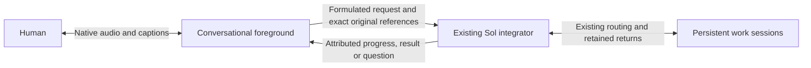

# Native voice foreground over the existing integrator

Human selection:1November2026. Owns the next #301/#302/#303/#304 implementation;
[this roadmap](interaction-roadmap.md) retains the complete horizon. This is an
implementation contract, not a claim that native speech is deployed.

## Conversation ownership

The person talks to a fluent voice layer. It listens, discusses, asks useful
clarifications and helps formulate a prompt. Ordinary conversation does not
create a Sol turn or worker task. When content requires resolution, the voice
layer submits it asynchronously to the existing integrating Conversation.
The Sol integrator retains routing, work progression and final-return ownership;
its persistent workers keep their own sessions. Integrating results/questions
return to the voice layer, which remains the interlocutor throughout.

A formulation is an attributed assistant derivative, never replacement human
speech. Preserve exact original utterances/transcripts, chronology and correction
relationships, alongside the selected prompt and its source references. A
partial caption or provider turn rotation does not admit a new work request.
Server authorization and existing task/approval boundaries still own effects;
voice tools do not gain direct worker, shell, global Stop or publication access.

## Recovered decisions and observed limits

The retained15October integrating-conversation research already separates a
Talker from a Reasoner, persistent work from temporary delegation, and returned
reports from job ownership. Its Qwen Live Harness inspection identifies useful
adapter/report scheduling seams; its in-memory report ledger is not our durable
work registry. Retain our existing owners and journals rather than adopting a
whole replacement harness.

The18October native account WebRTC experiment produced decoded synthetic Spanish
audio and incorporated a later correction. The earlier WebSocket API-key refusal
was transport-specific. That experiment did not qualify controlled backing-work
admission: client-managed handoff can suppress forwarding while native core still
starts work. Prompt-only instructions cannot fix that boundary. The26October
speech frontier retained these alternatives and the modular recovery path; its
initial modular recommendation is superseded for the fluent foreground by the
current human correction, not rewritten as if it had selected this rollout.

Current human evidence: avatar-only interaction occurred, but the person reports
nearly a minute before useful speech and an overlap on resuming speech. This
contradicts fluid-dialogue acceptance. Existing digital6–13second observations,
source primitives and a successful automatic upload do not establish fluency.

## Provider decision and actual access

First engineering candidate: **Gemini3.8Live**. Existing server credential and
read-only model discovery expose `gemini-3.8-live` and
`gemini-3.8-live-extended-thinking` with `bidiGenerateContent`. This is catalog
metadata only. Use native audio for this layer; retain Sol6.1/openai/medium
integrator/worker selection and existing Qwen rendering for ordinary paths.

- [Gemini Live](https://ai.google.dev/gemini-api/docs/live-api) documents native
  bidirectional audio, transcripts and interruption. Its
  [tool guide](https://ai.google.dev/gemini-api/docs/live-api/tools) describes
  nonblocking function execution and response scheduling. Verify those exact
  capabilities on the selected model; the documentation mixes model generations.
- [Extended thinking](https://ai.google.dev/gemini-api/docs/live-api/thinking)
  separates ongoing interaction from background reasoning. It remains a candidate
  if needed; fillers are not useful-response latency, and persistent Sol work
  must not become a hidden second reasoning job on every spoken exchange.
- [OpenAI Realtime](https://developers.openai.com/api/docs/guides/realtime-conversations)
  offers native speech, tools and interruption/truncation. Keep the already-tested
  account WebRTC route as the alternative, with its actual admission caveat;
  subscription login is not proof of general API-key entitlement.
- [Qwen Omni](https://help.aliyun.com/en/model-studio/realtime) documents native
  duplex audio and tools. Current3.8 deployment requires selected regional
  workspace access; existing3.0ASR/TTS use alone does not prove that grant.

No new account, purchase, provider ranking or voice migration follows from this
selection. One bounded synthetic native-audio/nonblocking-tool probe can resolve
that first protocol uncertainty. It cannot replace real audio-input, integrating
admission, interruption/reconnect, phone hearing or useful-latency acceptance.

## Selected-provider boundary observed —1November2026

One fresh bounded Gemini3.8Live session accepted the nonblocking tool declaration.
With one fake integrator call still pending, a separate synthetic conversational
prompt produced nonzero native PCM and the spoken response “Cinco”. Only then
was the fake integrator result returned; the model subsequently spoke its result.
The retained outcome records one tool call,240484PCM bytes and7.073seconds total
session time. This is a text-triggered native-audio/tool-concurrency observation,
not speech-input latency, real Sol delegation, physical hearing or app deployment.
No real native admission, human recording, worker action or provider retry ran.
The first implementation can therefore use the observed nonblocking seam rather
than adding a second reasoning turn for each casual spoken exchange.

## Implementation order and concrete seams

1. Inspect and extend the current owner APIs before adding a transport. Existing
   `TranscriptionStream` is deliberately transcription-only; do not quietly turn
   that recovery adapter into a conversational agent. Reuse its private server
   credential custody and supported WebSocket library, not its final-WAV gating.
2. Keep a foreground exchange independent of native job admission. The current
   ordinary input writer starts native work; sending every chatter utterance
   through it unchanged would recreate the serial path. Extend the existing
   original/source journal with explicit foreground provenance and one retained
   delegation intent. Do not fabricate a human user message from a model summary.
3. Give the voice layer a small server-owned integrator bridge: submit a request
   tied to exact originals, observe its existing retained status, and receive its
   attributed returns. Ack means accepted, not resolved. Reuse current source
   revisions, frozen question scope, uncertainty and canonical return ownership;
   do not install another worker registry or model poller.
4. Keep the native audio loop free of native-turn/ASR-final/TTS waits. On an
   interruption, silence/discard only the affected output and track heard/unsaid
   context. Provider tool-call cancellation does not cancel admitted Sol work.
   A disconnected voice session observes existing outcomes on return, without
   reauthoring jobs or resubmitting uncertain provider/native requests.
5. Mount the qualified adapter inside the existing avatar view and shared login,
   retaining normal composer drafts, files, reply selection, text access and
   ordinary chat. Expose the real selected mode and actual readiness/errors.
   Keep server-side credentials private and current actor/generation checks on
   tool effects. Preserve ongoing captures during receiving adoption.

## Foreground original retention seam

The owner command `input foreground retain JSON` accepts `binding`, `id`, `text`,
`dialogue_id` and an optional frozen `capture_questions` narrowing map. It stores
an exact original in the existing conversation journal with phase `foreground`.
Status and history expose that grouping; `native_acceptance` is `not_requested`.
It neither routes work, answers questions nor calls the native worker. Repeating
the exact identity observes the retained original; changing its text or dialogue,
or submitting it through the ordinary input command, is rejected. The ordinary
input schema and admission behavior remain unchanged.

The separate owner command `input foreground delegate JSON` takes `binding`,
`id` (the latest original), `intent_id`, `formulation` and `source_ids`. It freezes
up to8same-dialogue originals in capture order, their exact text/hash and captured
server question versions, under an immutable intent. Source context is bounded
to64KiB and the assistant formulation to8KiB. A newer captured correction must be
the root. The original text remains unchanged. Admission queues that root directly
to the existing integrator, bypassing voice-selected destinations and automatic
question answering. A repeated exact intent only observes its outcome, including
uncertainty or known-unsent restart recovery; it never resubmits work. Changing
its formulation, source set or intent identity is rejected.

The integrator receives a labelled assistant derivative and exact frozen sources.
If it later dispatches the selected original, the normal worker packet carries
that same attributed context beside the unchanged human text. Ordinary routing,
source identity validation and return ownership remain in force. The native
socket regression deliberately includes an unknown worker selector in the latest
original: delegation still enters the integrator once rather than selecting that
worker from the voice layer.

These are native owner primitives under implementation, not an activated browser
mode. The dialogue UUID groups originals and grants no authority. The live
audio/activity capture bridge and avatar mounting remain unfinished. Store/restart and
owner-socket regressions exercise exact-source identity, stale/cross-dialogue
rejection, once-only delegated admission and absence of work for casual retention,
without invoking a model.

## Source-bound foreground audio retention

The server-side `Provider.conversation_voice_submit` supports an explicit
`foreground_dialogue` keyword; ordinary HTTP uploads do not expose that keyword.
The same private bounded WAV store, hash checks, selected original-media protection,
decoder and native capture journal are reused. Foreground capture requires the
configured completed-transcript reader, which cannot initiate file ASR. A missing
receipt remains recoverable preparation, never a fallback model call or work
admission. Native3.8 transcripts use the same source/hash/PCM-verified prepared
receipt as the existing transcription providers.

At the acoustic endpoint, the server can retain the exact WAV with
`defer_foreground=True` before its provider transcript arrives. This records
`foreground_captured` and receiver capture order without starting any reader or
work. A later `conversation_foreground_complete` reads only the now-completed
receipt for that same original/dialogue. Restart retains the captured source and
its frozen question scope. A delayed transcript cannot move it after a later
captured correction. Capacity-unavailable foreground preparation follows that
same known-unsent capture path; no failed provider operation is retried.

After committing that receiving-owned proof, the native capture moves to
`foreground` and does not invoke routing, answer a question or submit a Sol turn.
Explicit later delegation includes the voice proof in its frozen source context,
retaining automatic-transcription attribution. Ordinary chat and capture/recovery
keep their existing behavior. Source context also bounds the entire encoded
retained outcome to192KiB, below the existing256KiB owner reply limit, so JSON
escaping cannot leave a queued request with an unreadable acknowledgment.

This completes the owner-side audio commit primitive; the live activity/source
bridge, session continuity and avatar mounting remain unfinished. It does not
claim a natural end-of-phrase or phone qualification. Original byte retirement
continues through the existing policy after durable text and any selected media
protection, with the same256MiB unresolved-capture budget; no new archive or
background retention process is introduced.

## Native dialogue transport seam

`dashboard/native_dialogue.py` implements the dedicated Gemini3.8Live transport;
ordinary `TranscriptionStream`, Sol configuration and Qwen rendering are unchanged.
The transport requires explicit `manual` or `automatic` activity ownership and
supports concurrent PCM input, audio output, captions and nonblocking integrator
proposals. Manual start/end are bridge-owned acoustic events, never text captions;
provider acknowledgments of those events are labelled separately from automatic
voice detection. Stopping a microphone closes its active manual activity or sends
the documented automatic-mode `audioStreamEnd`. It has no native
submission, worker, storage, reconnect or automatic retry capability. Proposals
carry an assistant formulation and bounded original IDs; only the owning bridge
can validate their actual retained source/actor/binding and admit work.

The adapter exposes provider input transcripts separately from interim captions.
It deliberately does not interpret model output or `turnComplete` as a final human
original: the [Live protocol](https://ai.google.dev/api/live) gives no guaranteed
ordering between input transcription and other events. The capture/source bridge
still needs to establish durable utterance/audio boundaries before delegation.
Provider cancellation is a cancelled speech proposal, never a native job cancel.
An interrupted event clears output, including audio in that same event. A tool
response is marked uncertain before writing and cannot be sent twice.

Each connection is limited to300seconds,300seconds of16kHz input and24kHz output,
16384provider events,256KiB per event,128KiB total transcripts,32tool proposals and
4pending proposals. Each input frame is at most one second; request/source lists
and returned outcomes are bounded. The adapter retains no media or transcripts
after its owner releases it and never opens a replacement connection. Longer
conversation continuity belongs to the existing durable source/result bridge,
not automatic replay. Synthetic socket regressions cover concurrent speech while
a tool is pending, interruption, once-only uncertain returns and resource bounds;
they establish no real audio-input, native admission, avatar or phone acceptance.

## Actual audio-input qualification —1November2026

The synthetic audio-input journey did not establish automatic end-of-phrase:
setup succeeded, but continuous PCM and silence produced no transcript, activity
or output before the finite deadline. Documented microphone-stop handling and
the official SDK's outer message spelling did not resolve that observation.
Explicitly enabling automatic detection likewise produced no response. Those
outcomes remain retained failures, not fluency or provider-wide capability claims.

A distinct diagnostic using the supported manual activity protocol did produce
an input transcript, provider activity acknowledgments and native PCM with the
matching arithmetic answer. Its first audio arrived674ms after the explicit
microphone-stop signal; the entire synthetic session lasted12.323seconds. This
is a protocol/audio-intake observation, not independently heard speech or a
measurement from a natural intended pause. No human recording or Sol/native
work admission was used. The provider transcript omitted the synthetic greeting;
retain original audio and label its transcript as an automatic interpretation,
never assume that transcription alone preserves the entire spoken original.

The first source/capture bridge must therefore use explicit, owned acoustic
activities for the observed manual protocol, with the existing detector and its
actual offsets. Keep audio generation independent of final file ASR, Sol work
and separate TTS. The automatic provider mode remains unqualified. Device end
of phrase, echo/noise, interruption and useful latency still require an integrated
journey; successful explicit start/end cannot close those acceptance items.

## Bounds and acceptance

Start with one owned synthetic provider session,60seconds, at most1024events,
4MiB generated PCM and192output tokens per response; one delayed fake integrator
call and one second conversational prompt. No hardware, existing human recording,
real worker action, new native input, reconnect or replay. Retain its terminal
outcome and metadata; only reproducible synthetic media may be retired later.

Then qualify the actual integrator bridge and audio-input/output journey under
finite selected capture/output budgets. Show useful speech while an integrator
request is pending, a later sourced return, a spoken prompt correction, speech
interruption without worker cancellation, and reconnect with once-only originals.
Measure final intended speech→first intelligible sound and interruption→silence
on the same journey; count neither filler nor first text as spoken acceptance.
Phone/echo/noise acceptance stays distinct. Existing selected participants' access,
bounded media retention and ordinary original recovery remain requirements.
