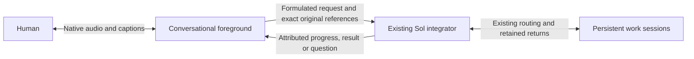

# Native voice foreground over the existing integrator

Human selection:1November2026. Owns the next #301/#302/#303/#304 implementation;
[this roadmap](interaction-roadmap.md) retains the complete horizon. This is an
implementation contract. The opt-in receiving pilot and bounded provider/browser
evidence are recorded in the roadmap and qualification record; physical-device
acceptance remains open.

## Conversation ownership

The person talks to a fluent voice layer. It listens, discusses, asks useful
clarifications and helps formulate a prompt. Ordinary conversation does not
create a Sol turn or worker task. When content requires resolution, the voice
layer submits it asynchronously to the existing integrating Conversation.
The Sol integrator retains routing, work progression and final-return ownership;
its persistent workers keep their own sessions. Integrating results/questions
return to the voice layer, which remains the interlocutor throughout.

The foreground distinguishes exploring an idea from requesting its execution.
It handles explanations and prompt refinement conversationally, uses available
context, and asks a brief clarification only when a missing detail materially
changes the requested outcome. A clear request goes to Sol without a redundant
confirmation step. Its formulation preserves constraints, uncertainty and
corrections. New speech remains conversational while work is pending; filler
acknowledgments do not count as useful-response latency.
After observed admission, the foreground should briefly confirm the actual
formulated request was handed over and stay conversational rather than wait
silently for its result. Pending/unconfirmed native acceptance is described as
such. This confirmation is an admission-status acknowledgment, not a useful work
result or evidence that the worker completed anything.
The confirmation describes the request as sent. It cannot imply that a named
worker received or started it from integrator admission alone; that requires
canonical worker confirmation.

Keep the work product separate from its spoken presentation. A request for a
complete unsummarized report with only its conclusion spoken still requires the
complete report to return to the integrator. Speech-only brevity or reading
preferences apply in this foreground, without restricting the worker deliverable.
A retained actual-Sol attempt exposed an ambiguous formulation and a spoken
acknowledgment that instead described requesting only the conclusion. This does
not prove a worker returned the wrong product: the fixture ended before a result.

When a requested conclusion/detail is absent from the current return page and a
next_offset exists, read onward before answering; describing where the answer
would be is not the answer. Continue only until the requested information is
found or that current source ends, under existing finite read/tool/session limits.
A distinct bounded native-provider check with simulated original/integrator
callbacks preserved the complete report, confirmed only that the request was
sent, read offset1600 of2370 and generated the granate conclusion. One earlier
candidate preserved the report but did not read past the first-page description;
its terminal failure remains retained. This is provider-policy evidence, not
actual-Sol/worker/device/hearing or general-latency acceptance.


Two bounded synthetic native-audio policy trials on1November observed the
exploration/execution distinction and this admission response separately. With
the earlier instruction, exploration stayed conversational and the later
explicit request used its supplied original reference, but no assistant output
preceded the deliberately delayed fake result. With the explicit admission
instruction, a separate one-request trial generated confirmation text536ms
after fake admission, before the delayed result, then presented that result.
Both used one provider connection and fake tools only, with no Sol/worker job,
human original, app change or hardware capture. This is an observed policy
response, not a controlled latency comparison or receiving acceptance. The
first PCM event contained only two bytes; it cannot establish intelligible
sound. Useful-result and physical-playback latency remain separate open measures.

On opening, assistant voice context is selected from the current integrating
binding. Earlier bindings remain in readable history, but are not silently
injected into the new voice conversation. Playback positions remain client
observations, not proof that the person heard the generated words.
The existing `recent_originals` read also includes up to four assistant speech
observations from the current dialogue and binding, within its16KiB tool-result
bound. It carries bounded generated-text excerpts, interruption/closed flags and
generated/client-playback byte positions. A later read reflects later playback;
this starts no native work and creates no second speech registry. The model must
not map those positions to exact heard words: they are neither word alignment
nor a contiguous hearing receipt. Phone interruption/correction acceptance
remains separate from this context plumbing.



A formulation is an attributed assistant derivative, never replacement human
speech. Preserve exact original utterances/transcripts, chronology and correction
relationships, alongside the selected prompt and its source references. A
partial caption or provider turn rotation does not admit a new work request.
Server authorization and existing task/approval boundaries still own effects;
voice tools do not gain direct worker, shell, global Stop or publication access.

## Recovered decisions and observed limits

The retained15October integrating-conversation research already separates a
Talker from a Reasoner, persistent work from temporary delegation, and returned
reports from job ownership. Its Qwen Live Harness inspection identifies useful
adapter/report scheduling seams; its in-memory report ledger is not our durable
work registry. Retain our existing owners and journals rather than adopting a
whole replacement harness.

The18October native account WebRTC experiment produced decoded synthetic Spanish
audio and incorporated a later correction. The earlier WebSocket API-key refusal
was transport-specific. That experiment did not qualify controlled backing-work
admission: client-managed handoff can suppress forwarding while native core still
starts work. Prompt-only instructions cannot fix that boundary. The26October
speech frontier retained these alternatives and the modular recovery path; its
initial modular recommendation is superseded for the fluent foreground by the
current human correction, not rewritten as if it had selected this rollout.

A later three-phrase synthetic browser/CPU/native session on ec883adf records
first scheduled nonquiet10ms waveform windows about1.29–1.41seconds after its
last synthetic input signal, with correct native response captions. This replaces
neither the historical first-event metrics nor physical/useful-word acceptance.
The [qualification record](interaction-qualification.md#native-waveform-timing-observations-1november2026)
retains the method, failed fixture cardinality/API assumptions, existing-data
verification and limits; no provider input was repeated to repair the verifier.

Current human evidence: avatar-only interaction occurred, but the person reports
nearly a minute before useful speech and an overlap on resuming speech. This
contradicts fluid-dialogue acceptance. Existing digital6–13second observations,
source primitives and a successful automatic upload do not establish fluency.

## Provider decision and actual access

First engineering candidate: **Gemini3.8Live**. Existing server credential and
read-only model discovery expose `gemini-3.8-live` and
`gemini-3.8-live-extended-thinking` with `bidiGenerateContent`. This is catalog
metadata only. Use native audio for this layer; retain Sol6.1/openai/medium
integrator/worker selection and existing Qwen rendering for ordinary paths.

- [Gemini Live](https://ai.google.dev/gemini-api/docs/live-api) documents native
  bidirectional audio, transcripts and interruption. Its
  [tool guide](https://ai.google.dev/gemini-api/docs/live-api/tools) describes
  nonblocking function execution and response scheduling. Verify those exact
  capabilities on the selected model; the documentation mixes model generations.
- [Extended thinking](https://ai.google.dev/gemini-api/docs/live-api/thinking)
  separates ongoing interaction from background reasoning. It remains a candidate
  if needed; fillers are not useful-response latency, and persistent Sol work
  must not become a hidden second reasoning job on every spoken exchange.
- [OpenAI Realtime](https://developers.openai.com/api/docs/guides/realtime-conversations)
  offers native speech, tools and interruption/truncation. Keep the already-tested
  account WebRTC route as the alternative, with its actual admission caveat;
  subscription login is not proof of general API-key entitlement.
- [Qwen Omni](https://help.aliyun.com/en/model-studio/realtime) documents native
  duplex audio and tools. Current3.8 deployment requires selected regional
  workspace access; existing3.0ASR/TTS use alone does not prove that grant.

No new account, purchase, provider ranking or voice migration follows from this
selection. One bounded synthetic native-audio/nonblocking-tool probe can resolve
that first protocol uncertainty. It cannot replace real audio-input, integrating
admission, interruption/reconnect, phone hearing or useful-latency acceptance.

## Selected-provider boundary observed —1November2026

One fresh bounded Gemini3.8Live session accepted the nonblocking tool declaration.
With one fake integrator call still pending, a separate synthetic conversational
prompt produced nonzero native PCM and the spoken response “Cinco”. Only then
was the fake integrator result returned; the model subsequently spoke its result.
The retained outcome records one tool call,240484PCM bytes and7.073seconds total
session time. This is a text-triggered native-audio/tool-concurrency observation,
not speech-input latency, real Sol delegation, physical hearing or app deployment.
No real native admission, human recording, worker action or provider retry ran.
The first implementation can therefore use the observed nonblocking seam rather
than adding a second reasoning turn for each casual spoken exchange.

## Implementation order and concrete seams

1. Inspect and extend the current owner APIs before adding a transport. Existing
   `TranscriptionStream` is deliberately transcription-only; do not quietly turn
   that recovery adapter into a conversational agent. Reuse its private server
   credential custody and supported WebSocket library, not its final-WAV gating.
2. Keep a foreground exchange independent of native job admission. The current
   ordinary input writer starts native work; sending every chatter utterance
   through it unchanged would recreate the serial path. Extend the existing
   original/source journal with explicit foreground provenance and one retained
   delegation intent. Do not fabricate a human user message from a model summary.
3. Give the voice layer a small server-owned integrator bridge: submit a request
   tied to exact originals, observe its existing retained status, and receive its
   attributed returns. Ack means accepted, not resolved. Reuse current source
   revisions, frozen question scope, uncertainty and canonical return ownership;
   do not install another worker registry or model poller.
4. Keep the native audio loop free of native-turn/ASR-final/TTS waits. On an
   interruption, silence/discard only the affected output and track heard/unsaid
   context. Provider tool-call cancellation does not cancel admitted Sol work.
   A disconnected voice session observes existing outcomes on return, without
   reauthoring jobs or resubmitting uncertain provider/native requests.
5. Mount the qualified adapter inside the existing avatar view and shared login,
   retaining normal composer drafts, files, reply selection, text access and
   ordinary chat. Expose the real selected mode and actual readiness/errors.
   Keep server-side credentials private and current actor/generation checks on
   tool effects. Preserve ongoing captures during receiving adoption.

## Foreground original retention seam

The owner command `input foreground retain JSON` accepts `binding`, `id`, `text`,
`dialogue_id` and an optional frozen `capture_questions` narrowing map. It stores
an exact original in the existing conversation journal with phase `foreground`.
Status and history expose that grouping; `native_acceptance` is `not_requested`.
It neither routes work, answers questions nor calls the native worker. Repeating
the exact identity observes the retained original; changing its text or dialogue,
or submitting it through the ordinary input command, is rejected. The ordinary
input schema and admission behavior remain unchanged.

The separate owner command `input foreground delegate JSON` takes `binding`,
`id` (the latest original), `intent_id`, `formulation` and `source_ids`. It freezes
up to8same-dialogue originals in capture order, their exact text/hash and captured
server question versions, under an immutable intent. Source context is bounded
to64KiB and the assistant formulation to8KiB. A newer captured correction must be
the root. The original text remains unchanged. Admission queues that root directly
to the existing integrator, bypassing voice-selected destinations and automatic
question answering. A repeated exact intent only observes its outcome, including
uncertainty or known-unsent restart recovery; it never resubmits work. Changing
its formulation, source set or intent identity is rejected.

The integrator receives a labelled assistant derivative and exact frozen sources.
If it later dispatches the selected original, the normal worker packet carries
that same attributed context beside the unchanged human text. Ordinary routing,
source identity validation and return ownership remain in force. The native
socket regression deliberately includes an unknown worker selector in the latest
original: delegation still enters the integrator once rather than selecting that
worker from the voice layer.

These are native owner primitives under implementation, not an activated browser
mode. The dialogue UUID groups originals and grants no authority. The live
audio/activity capture bridge and avatar mounting remain unfinished. Store/restart and
owner-socket regressions exercise exact-source identity, stale/cross-dialogue
rejection, once-only delegated admission and absence of work for casual retention,
without invoking a model.

## Source-bound foreground audio retention

The server-side `Provider.conversation_voice_submit` supports an explicit
`foreground_dialogue` keyword; ordinary HTTP uploads do not expose that keyword.
The same private bounded WAV store, hash checks, selected original-media protection,
decoder and native capture journal are reused. Foreground capture requires the
configured completed-transcript reader, which cannot initiate file ASR. A missing
receipt remains recoverable preparation, never a fallback model call or work
admission. Native3.8 transcripts use the same source/hash/PCM-verified prepared
receipt as the existing transcription providers.

At the acoustic endpoint, the server can retain the exact WAV with
`defer_foreground=True` before its provider transcript arrives. This records
`foreground_captured` and receiver capture order without starting any reader or
work. A later `conversation_foreground_complete` reads only the now-completed
receipt for that same original/dialogue. Restart retains the captured source and
its frozen question scope. A delayed transcript cannot move it after a later
captured correction. Capacity-unavailable foreground preparation follows that
same known-unsent capture path; no failed provider operation is retried.

After committing that receiving-owned proof, the native capture moves to
`foreground` and does not invoke routing, answer a question or submit a Sol turn.
Explicit later delegation includes the voice proof in its frozen source context,
retaining automatic-transcription attribution. Ordinary chat and capture/recovery
keep their existing behavior. Source context also bounds the entire encoded
retained outcome to192KiB, below the existing256KiB owner reply limit, so JSON
escaping cannot leave a queued request with an unreadable acknowledgment.

This completes the owner-side audio commit primitive; the live activity/source
bridge, session continuity and avatar mounting remain unfinished. It does not
claim a natural end-of-phrase or phone qualification. Original byte retirement
continues through the existing policy after durable text and any selected media
protection, with the same256MiB unresolved-capture budget; no new archive or
background retention process is introduced.

## Native dialogue transport seam

`dashboard/native_dialogue.py` implements the dedicated Gemini3.8Live transport;
ordinary `TranscriptionStream`, Sol configuration and Qwen rendering are unchanged.
The transport requires explicit `manual` or `automatic` activity ownership and
supports concurrent PCM input, audio output, captions and nonblocking integrator
proposals. Manual start/end are bridge-owned acoustic events, never text captions;
provider acknowledgments of those events are labelled separately from automatic
voice detection. Stopping a microphone closes its active manual activity or sends
the documented automatic-mode `audioStreamEnd`. It has no native
submission, worker, storage, reconnect or automatic retry capability. Proposals
carry an assistant formulation and bounded original IDs; only the owning bridge
can validate their actual retained source/actor/binding and admit work.

The adapter exposes provider input transcripts separately from interim captions.
Transcription text is optional in the provider schema. Empty transcription
metadata without an explicit input-end marker is ignored, while audio carried
in that same message is still delivered. A mounted real-provider trial observed
`outputTranscription:{}` alongside generated PCM; requiring its missing text
closed the session. The regression reproduces that rejection and verifies that
the corrected parser keeps the audio without inventing a human transcript.
It deliberately does not interpret model output or `turnComplete` as a final human
original: the [Live protocol](https://ai.google.dev/api/live) gives no guaranteed
ordering between input transcription and other events. The capture/source bridge
still needs to establish durable utterance/audio boundaries before delegation.
Provider cancellation is a cancelled speech proposal, never a native job cancel.
An interrupted event clears output, including audio in that same event. A tool
response is marked uncertain before writing and cannot be replayed. The return
subscription uses the provider's documented
[`FunctionResponse.willContinue`](https://googleapis.github.io/js-genai/release_docs/classes/types.FunctionResponse.html)
to stream distinct canonical updates on one nonblocking call. Receiving an
acknowledgment does not end that subscription or depend on another model call.

Each connection is limited to300seconds,300seconds of16kHz input and24kHz output,
16384provider events,256KiB per event,128KiB total transcripts,32tool proposals and
4pending proposals and160total tool responses, including streamed updates.
Only admitted delegation and return-subscription calls can continue. Each input frame is at most one second; request/source lists
and returned outcomes are bounded. The adapter retains no media or transcripts
after its owner releases it and never opens a replacement connection. Longer
conversation continuity belongs to the existing durable source/result bridge,
not automatic replay. Synthetic socket regressions cover concurrent speech while
a tool is pending, interruption, once-only uncertain returns and resource bounds;
they establish no real audio-input, native admission, avatar or phone acceptance.

Native input applies bounded backpressure at the existing256000queued PCM-byte
or128message bound. It retains the next validated frame (at most32000bytes)
without reading further network frames while waiting up to3seconds for consumer
space. Failure to drain still closes to retained review; malformed frames are
rejected before waiting. Every batch still requires fresh authorization and
keeps exact PCM/control ordering. Default prepared/file-ASR and provider/detector
event inboxes retain their previous immediate overflow behavior.

A2November phone trial on544 filled that PCM queue and closed at the collector
after34.587seconds, with no activity-offset mismatch. A deterministic queued
burst reproduced the same80frame/256000byte rejection before the consumer could
drain. The new mounted shared-cookie fixture holds authorization during a burst,
then verifies all320000bytes reach analysis with the original queue bound. This
qualifies burst recovery, not proof that a burst rather than another delay caused
that phone queue to fill, nor physical playback/continuous-experience acceptance.

The native readiness frame can advertise `playback_status:true`. Only that
explicit capability enables at most32client observations per dialogue; an old
receiver gets no unknown control. They contain only six bounded counters
(handled/scheduled/ended buffers and skips for floor/mute/retired output), four
boolean gates and one fixed context-state enum. They carry no text/media/source
IDs, cannot update playback positions or admit work, and do not change playback
policy. The server validates exact fields/types/bounds and retains only the first
observation with handled audio and the last accepted observation in the existing
close summary, explicitly labelled untrusted client observations. Missing reports
from old clients do not establish a healthy or silent player. Scheduling, a
running context or a buffer end still does not prove physical hearing.

The native owner exposes explicit audio pause/enable state separately from its
acoustic floor. While capture stays active, the fullscreen avatar reuses its
existing action as `Resume audio` or `Enable audio` when needed, and labels the
paused/off state. The explicit gesture calls the current owner's enable/resume
path, never microphone start, another connection or work admission. Automatic
floor suspension does not expose this action or clear an intentional pause.
This recovery path does not identify the cause of the reported phone silence,
reset playback automatically or establish physical hearing acceptance.

Native manual activity uses the existing owned acoustic worker with an explicit
1600ms silence endpoint as a fallback when the semantic score does not close a
phrase. The event is labelled `acoustic_silence`, with measured silence duration,
not a semantic completion probability or proof of final intended words. Only
confirmed speech can establish that boundary. A resumed utterance can interrupt
the response and supply a correction; a pause does not cancel native work.
Ordinary prepared/file-ASR modes retain their previous semantic-only policy.
The worker advertises the selected silence policy at readiness, before opening
the paid provider or requesting the browser microphone; an old worker cannot
silently impersonate support. Receiving adoption must select the matching
`capture_turn.py` command and completed-transcript reader with the backend.

The acoustic worker commits a new voice generation only after three consecutive
positive VAD frames. A one/two-frame candidate remains provisional. Previously,
such a candidate advanced the generation before confirmation, so a noise spike
following a still-open phrase could leave its generation unmatched and disable
both completion paths even after a later quiet tail. The regression reproduces
confirmed speech, a rejected semantic completion, a short spike and1600ms quiet;
the existing phrase now ends exactly once. Confirmed resumed speech still opens
the next generation across partial PCM reads, and exact source bytes, offsets,
question scope and recovery are unchanged. This repairs that deterministic state
failure; it does not prove arbitrary car-noise classification. Learned VAD
probabilities are not word-recognition receipts.

After the existing seven-negative-frame release, a new speech candidate must
also meet that three-positive-frame requirement before setting `speaking` or
resetting elapsed quiet. Repeated one/two-frame spikes cannot indefinitely hold
an already released phrase open. Both semantic and silence endpoints wait while
a candidate is incomplete, so a real third positive frame can resume speech
without being split at the inactivity deadline. Established speech retains its
existing continuation rule: each positive frame still resets quiet, including
voiced/unvoiced patterns that never require a new onset. The fallback duration
therefore measures time without confirmed speech reacquisition, including
rejected candidates, rather than exclusively below-threshold frames. Continuous
false positives while already speaking and arbitrary road noise remain separate
classifier/noise-processing and physical-device qualification gaps.

## Actual audio-input qualification —1November2026

The synthetic audio-input journey did not establish automatic end-of-phrase:
setup succeeded, but continuous PCM and silence produced no transcript, activity
or output before the finite deadline. Documented microphone-stop handling and
the official SDK's outer message spelling did not resolve that observation.
Explicitly enabling automatic detection likewise produced no response. Those
outcomes remain retained failures, not fluency or provider-wide capability claims.

A distinct diagnostic using the supported manual activity protocol did produce
an input transcript, provider activity acknowledgments and native PCM with the
matching arithmetic answer. Its first audio arrived674ms after the explicit
microphone-stop signal; the entire synthetic session lasted12.323seconds. This
is a protocol/audio-intake observation, not independently heard speech or a
measurement from a natural intended pause. No human recording or Sol/native
work admission was used. The provider transcript omitted the synthetic greeting;
retain original audio and label its transcript as an automatic interpretation,
never assume that transcription alone preserves the entire spoken original.

The first source/capture bridge selected explicit, owned acoustic activities
for the observed manual protocol, with the existing detector and its actual
offsets. Audio generation stays independent of final file ASR, Sol work and
separate TTS. The automatic mode was unqualified at that point; the distinct
2November natural-speech result below supersedes that limit. Device end
of phrase, echo/noise, interruption and useful latency still require an integrated
journey; successful explicit start/end cannot close those acceptance items.

## Bounds and acceptance

Start with one owned synthetic provider session,60seconds, at most1024events,
4MiB generated PCM and192output tokens per response; one delayed fake integrator
call and one second conversational prompt. No hardware, existing human recording,
real worker action, new native input, reconnect or replay. Retain its terminal
outcome and metadata; only reproducible synthetic media may be retired later.

Then qualify the actual integrator bridge and audio-input/output journey under
finite selected capture/output budgets. Show useful speech while an integrator
request is pending, a later sourced return, a spoken prompt correction, speech
interruption without worker cancellation, and reconnect with once-only originals.
Measure final intended speech→first intelligible sound and interruption→silence
on the same journey; count neither filler nor first text as spoken acceptance.
Phone/echo/noise acceptance stays distinct. Existing selected participants' access,
bounded media retention and ordinary original recovery remain requirements.

## Live bridge implementation checkpoint

`dashboard/native_foreground.py` connects one bounded native speech session to
existing original retention, integrator admission and canonical text readers.
Its `recent_originals` tool returns genuine references; delegation requires the
latest captured correction and retains its distinct assistant formulation. Each
provider call ID can produce at most one owner invocation, including lost ACKs.
The first admitted delegation itself stays pending with `willContinue:true` and
owns the existing event-driven return reader. The model does not need to make a
second tool call to hear its result or a returned question. Later admissions
reuse that reader instead of creating another one. `await_integrator_update`
remains available for pending work without an active continued delegation/watch,
including recovery after provider cancellation. The speech stream remains
independent. The bridge re-reads the selected revision and rejects
obsolete content, pending corrections, worker progress and changed native bindings.
It never starts workers itself or treats admission as task completion.

A long integrating return retains its canonical `offset`/`next_offset` in the
voice tool response. `read_integrating_source` reads one requested page through
the existing presentation reader, restricted to exact source/revision pairs
already offered in this dialogue. Each page rechecks currentness, correction and
native-binding state, canonical kind and offset before returning text. An obsolete
source or unrelated ID returns no text; the foreground must not invent missing
details from a truncated first page. The offered-reference dictionary uses the
existing128offer/session bound; each read uses the same finite tool-call and
16KiB response bounds. It starts no work, answers no native question and creates
no parallel source store. Mocked transport, source ownership and mounted app
regressions cover a multi-page Unicode result and changed/unoffered sources;
these do not establish real-provider tool selection or phone hearing.

Reopening the avatar also makes its retained canonical setup excerpts readable.
Each eligible excerpt carries a character cursor after its at-most1200UTF-8-byte
text, including any remaining first-page text. Only references actually retained
in the32KiB setup context enter the same128offer registry. They are already
context, so no new spoken return or delegation is queued. Reads revalidate the
canonical revision as above; stale/correction-pending/native-obsolete sources
are omitted at setup, ordinary progress remains context-only. Retained human
originals and prior assistant speech are not promoted into this canonical read
scope. A mounted Unicode reconstruction failed with not_ready before the fix
and passes afterward; an independent bridge check retains no-repeat and stale
read rejection. This is source/fixture qualification, not deployment or model/
phone acceptance.

An answer to an integrating question or a correction to pending work must also
reach Sol through its retained originals, even if terse. The foreground cannot
replace that action with a spoken acknowledgment or claim forwarding before
observed admission. Original question/approval authority still belongs to the
existing integrator and native controls; no automatic native answer is added.
The source list must be refreshed after each new answer/correction; a cached ID
from the earlier request cannot replace that new original. The existing owner
rejects a proposal that omits the latest captured source without admitting work.

The bridge retains exact PCM as the existing private WAV before native control,
then uses the existing prepared-transcript receipt and completed reader. Closing
the voice session releases live buffers and wakes a pending return watch. A file
write already in progress owns immutable bytes until it finishes; closing speech
does not cancel an integrating task. Bounds remain300seconds/128captures,
4pending captures,2owner calls,1file writer and8queued source references. The opt-in WebSocket/avatar mounting is described below; no receiving deployment
is established by these source tests.

The native `voice capabilities` response advertises `foreground_retention: v1`
and `foreground_completed_reader`. The mounted mode checks both before offering its microphone; the current selected
receiving listener predates these fields.
Source mounting, assistant speech history and playback are implemented behind
the opt-in flag below. The actual provider/native/device journey remains open.

`dashboard/native_acoustic.py` maps the existing server detector's exact onset
and endpoint observations to the observed manual native-audio protocol. An
endpoint sends `activityEnd` before transcript completion, native admission or
integrator work. Only analyzed PCM reaches that stream, and the retained closed
WAV contains those exact bytes. A single outstanding provider activity owns its
finalized input transcript and matching manual start/end audio offsets. Output
completion and interim captions do not finalize originals. Up to4local phrases
can wait in acoustic order while that correlation finishes; native reservations
also serialize so a slower earlier write cannot reverse ingress chronology.
Closing retains an unfinished phrase's captured tail without delegating it.

Explicit fragmented input transcription preserves the provider's optional
[`finished` marker](https://googleapis.github.io/js-genai/release_docs/interfaces/types.Transcription.html).
Marked fragments accumulate within the existing16000byte original bound, even
when arriving before local phrase end. A textless `finished:true` ends that
transcription; completion still requires the matching manual audio-end ACK.
Model output/turn completion does not substitute for it. Cumulative captions
remain visible; the empty end marker cannot erase them. Once fragmentation is
explicit, an unmarked later fragment does not silently become the full original.
The previously observed single unmarked transcript path remains supported.
Synthetic transport/acoustic/mounted tests establish these conditions, not that
the selected provider always emits this marker or preserves every long spoken
word. Real long-utterance and unmarked segmentation qualification remain open.

The acoustic adapter is mounted behind the opt-in native route. Its synthetic
tests establish offset
and source correlation, endpoint signaling before transcript arrival, bounded
backlog and preservation on close. They do not qualify the actual detector,
provider session, responsive speech or device behavior. The next paid provider
session must use the complete mounted source/audio/integrator journey rather
than another isolated arithmetic or transport probe.


## Opt-in mounted browser path

`streaming_transcription.native_dialogue = true` mounts the authenticated
`/api/interaction/voice/native` WebSocket when the existing prepared Gemini
credential and acoustic detector are configured. Default is false. The avatar
selects it only when the server advertises it and the browser supports the PCM
path. Android clients through0.5 retain the existing mode. The0.6 candidate
adds the same foreground protocol through the existing Android speech owner
and an AudioTrack PCM branch; source/CI APK is not device acceptance.
Normal chat, selected Sol workers, ASR and Qwen playback remain available.

The route reuses shared login, exact Origin, CSRF and current entry checks. It
checks the loaded native capabilities, completed reader and history capacity
before opening the provider or offering microphone acquisition. Input, detector
and provider events use bounded batches while fresh authorization is in flight;
there is no authorization cache. Each live route has a305second outer deadline,
one session per actor and the existing shared foreground-analysis capacity of
at most2sessions. A disconnected ASGI request cannot
skip provider closure or the separate bounded cleanup of already captured data.

Before microphone acquisition, a bounded source-labelled context includes recent
owned integrating text, original excerpts and assistant voice history. Those
prior source IDs are contextual only; a delegation still requires genuine
current-dialogue originals. One pending event-driven reader, normally attached
to the admitted delegation call, consumes current
integrating result/question references, not arbitrary worker history. Source
revision/currentness is checked again at offer time. Synthetic socket tests prove
that native audio continues while this watch is pending and that successive
canonical returns use the same subscription without repeating admission. Stale
sources are skipped without ending it; exact revisions are read again at offer
time. The session-new source window is revalidated on invalidations because
currentness/publication metadata can change without a new row ID.

The browser retains exact PCM ranges through the existing IndexedDB/WAV recovery
path until the authenticated server confirms matching original hashes **and durable
interpretations**. A raw-WAV retention ACK alone never retires the local copy. A first
local acoustic marker freezes that phrase's observed question versions before
its PCM is sent; the server intersects this narrowing scope with native-owned
questions. Missing markers retain the earlier arm-time fallback. No late Send,
retry or transcript completion widens that scope. Unconfirmed copies remain for
review on exit. Native PCM playback has a30second/512node queue bound, ordinary
speaker and pause/resume controls, and matching phrase-ACK fences against an
interrupted output restarting. A new local acoustic energy marker immediately
pauses output, including when playback is between chunks, but keeps the bounded
queue recoverable. RMS energy is a freshness hint, not speech authority. If quiet
server analysis covers that exact marker, the same output resumes unless the
human explicitly paused or disabled audio. Earlier analysis and repeated copies
of the same energy marker cannot release or reapply that fence. Pause once per
local energy episode; continuous noise cannot keep moving the fence ahead of the
server. A100ms local quiet gap rearms this provisional hint. Speech that starts
over continuous noise still interrupts on confirmed server onset. Confirmed server
capture_started retires the latest received output ID and queued output IDs;
late chunks still validate continuity but cannot restart them. A fresh output ID
can play after the existing phrase-ACK boundary. This supersedes the earlier
local-energy retirement behavior, which irreversibly discarded nonspeech output.
Fresh response PCM after the detected phrase end but before the matching manual
provider end-ACK stays queued in the paused owner; it must not be discarded.
Only that matching ACK plus the existing floor, energy and explicit-pause gates
allows release. Existing queue bounds still apply. Retired IDs and old tails
remain fenced; no audio is replayed to repair an unknown delivery.
Retired IDs are bounded by the existing finite session/event limit and cleared
on exit or a new session. The existing Chromium offline-audio qualification
renders both active-playback and between-chunk interruption, plus fresh output
afterward. It measures rendered graph silence at a synthetic confirmed onset,
not physical microphone-to-silence latency. A separate actual AudioContext case
checks immediate provisional suspension, a frozen output clock through stale
analysis, and completion of the same utterance after classified nonspeech. The
browser stays muted and uses a synthetic capture/socket, without a hardware mic. Browser playback counters are
observations, not proof of physical hearing or exact word uptake. Stopping a
queued buffer before its scheduled start reports no played bytes for that buffer;
its cumulative begin offset must not advance the utterance playback observation.
The offline-audio regression queues two chunks before interruption and checks
the reported position against elapsed rendered time as well as the silent tail.

Assistant utterances live as explicitly assistant-authored records in the
existing app state database. They are not human inputs or invented native work
results. Full text and Copy remain available in the normal timeline, including
interrupted text marked as possibly unheard, with bounded16item history paging.
History retains at most16384utterances/64MiB of text; capacity exhaustion stops
new native voice rather than deleting history. PCM/hash/playback/close updates
for an existing utterance keep their durable transaction without recounting all
actors' stored text. New rows and growing transcripts still check global quotas
inside the same writer transaction; no cached counter, schema change or pruning.
A populated4097-row regression at both text/row limits keeps sixteen PCM updates,
playback and closure within a deterministic SQLite work budget while refusing
new rows/text growth. The earlier per-fragment aggregate exhausts that budget.
This removes history-size-dependent work, not proof of phone/provider speedup.
No automatic expiry or archive is introduced. Existing original media retention remains its own owner. Only text
and turn changes notify the existing event stream; PCM/playback bookkeeping does
not cause whole-conversation refresh loops.

Current evidence is source and synthetic mounted journeys, including revoked
actor/old-listener refusal, exact WAV/source identity, independently retained
assistant history, asynchronous delegation/returns, ordered originals and browser
recovery/interruption controls. The real integrated provider/native journey,
useful-speech latency, precise heard/unsaid uptake, actual receiving adoption and
human device/hearing remain
unqualified. No new phone test is implied until those receiving steps finish.

## Receiving browser pilot —1November2026

PR496/sourceba9ed22 is receiving-selected as **UIc99f1b340f67**, after full
CI41303898080 and Android/decoder41303898081 passed. Exact local/public assets,
loaded native capabilities and the compatible worker/reader were verified.
Existing native writers/goals, the native daemon, Nexus source-policy environment
and unknown inputs were preserved. Ordinary chat/Qwen and Android native audio
retain their existing paths; the browser avatar explicitly opens this pilot.

A real mounted Gemini/Sol journey retained two originals, kept speech available
during pending work, handled interruption and spoke the canonical returned
recommendation using one continued subscription. Synthetic actors/worker/audio
and generated PCM do not establish rendered-browser or human hearing acceptance.
The first reply measured11.036s versus1.094s for the following conversational
response; useful latency and the remaining full roadmap are unfinished. The
human browser pause/response/interruption trial was requested for this exact UI.
See [qualification](interaction-qualification.md#native-foreground-qualification)
and the receiving operator record for current adoption and software rollback.
After native foreground originals exist, keep compatible native/completed-reader
support when restoring an earlier web UI; never roll back source journals.

A further distinct mounted qualification replaces the simulated worker with an
actual selected Sol6.1 worker. The foreground generates a correct casual answer
while that worker remains active, then speaks its canonical24133result after
Sol incorporates the complete verified100-prime report. Two casual originals
stay foreground-only; one work instruction/result and one continued speech
watch. The existing controller rejects the model's initial ineligible source-ID
selection before it inspects/selects the accepted formulation root; two attempts
do not become two tasks. Exact terminal native reads and bounds are recorded in
[qualification](interaction-qualification.md#actual-worker-and-conversational-concurrency--1november2026).
Synthetic capture/actor and generated PCM are not browser/phone/hearing or
useful-latency acceptance. Production receiving code is unchanged by this trial.

## Native avatar recovery feedback

When native voice stops with an unconfirmed original, its continuous state reports
review pending. The avatar shows the actual stop reason and the existing return
to conversation recovery action, and hides Start voice until that original is
reviewed. With no original, a stopped session still shows its reason rather than
leaving only Voice paused and an old caption. Ordinary composer/playback updates
do not erase that reason; explicitly starting voice again clears it. This uses
the existing local recording store/recovery path, not a second sender, retry or
provider action. It changes no endpointing, native admission or job cancellation.

## Missing native input finalization

After sending a manual activity end, the acoustic owner allows15seconds for the
matching end acknowledgment and final input interpretation. An event-driven
watch retires that deadline when the span completes; a later span gets its own
deadline. Missing final text or acknowledgment stops this voice stream with a
clear retained-recording review message. It does not synthesize a transcript,
accept an output/generation completion as human text, start file ASR, resend an
original or cancel integrating work. Closing the stream wakes/cancels the watch.

A bounded actual Gemini/CPU/Sol question trial retained a native Beta question and
an answer with that exact capture version. A later900ms acoustic span produced no
final input interpretation, leaving source reads waiting/retrying on the latest
capture instead of delegating the confirmed answer. The question was not answered
and no resumed worker result was emitted; the completed actual Sol root was read
idle and archived. The source/answer/tail remain retained without replay. The
observer also matched an admission mentioning both formats as a spoken question;
that predicate does not prove the actual question was voiced. Keep this incomplete
journey separate from earlier accepted report/return evidence.

Regression coverage checks missing final text and missing manual-end ACK, no
invented completion, a confirmed span retiring its deadline, close waking the
watch, and mounted-route review preserving exact original hash without delegation.
The fixed15second bound is preparation/recovery behavior, not useful-speech latency
or proof of device/provider acceptance.

## Complete canonical question offers

The live return reader also reuses the existing canonical For you request list,
under the same current integrating binding. It offers only pending actionable
questions, through the existing `request:ID`/revision presentation reader. Full
question text and choices are read at offer time; it does not depend on a later
Sol summary saying merely that a worker awaits a decision. This is the same
canonical routed/entry question lane as the UI, not the separate internal-session
question reader. Approvals and nonpending requests are excluded.

The foreground asks that actual question and relevant choices clearly, without
repeating it when a later summary adds no decision. Original capture versions,
answer interpretation and native decisions remain with the existing original/Sol/
question controls. No question reading answers, approves, dispatches or cancels.
Each invalidation rescans at most8canonical pages and selects at most32pending
questions, matching the existing capture-scope limit; existing8queued-reference/
128offered-reference and session/tool bounds remain unchanged. Exact revisions
are deduplicated; an answered or changed request retires its old offer without
ending the watch. Further pages use the same already-offered read-only source.

A mounted regression reproduces the missing full-question offer before the fix.
It covers full choices across two pages, exclusion of approvals/answered requests,
no delegation and a stale question followed by its next revision on one watch.
Actual provider/native/device acceptance remains distinct from these fixtures.

Before offering a question to the model, the same authenticated voice socket
sends its current canonical question-availability snapshot (`question_scope`,
binding and capture-version map) to the browser. The first local acoustic marker
freezes that observed snapshot for the phrase, independently of a delayed ordinary
For you refresh. A later snapshot cannot widen it; without a local marker the
earlier arm-time fallback stays frozen. Availability is not proof of hearing or
answer/approval authority, and the owner still intersects exact current versions.
The existing original/answer path and native controls are unchanged. Snapshot
changes are bounded/deduplicated; no separate registry or attention service exists.
Old clients ignore the additional event; a new client without it retains the
existing UI snapshot fallback. Receiver tests cover scope before immediate audio,
fresh canonical availability replacing a stale UI map, no late widening and the
no-marker fallback.

## Idle canonical-return attention

A newly opened avatar can receive a new canonical result before any human speech
or model-selected return watch. The previous adapter queued that result but
could remain silent until another phrase caused the model to subscribe. The
owner now sends one bounded `internal_integrator_update_available` control notice
when an unconsumed return is queued and no continued delegation/watch owns it.
This is a labelled server event, not human speech, an original, a function result,
new native work or permission to route. The voice model uses the existing
`await_integrator_update` tool; its normal revision-scoped reader still owns the
actual content. Existing pending calls need no extra model turn or subscription.
Historical setup excerpts are not queued or announced again by this change.

The notice uses the provider's documented
[incremental client content](https://ai.google.dev/gemini-api/docs/live-api/capabilities#incremental-content-updates).
That API can interrupt generation, so the owner defers while capture, a pending
interpretation/provider response or queued/paused speech owns the floor. Checks
run only on existing canonical invalidations, provider output and playback
receipts, with a final transport lock against a just-started activity/response.
The dialogue-indexed existing assistant history gates the latest serialized PCM
source; old partial/retired gaps are never rewritten into hearing receipts.
The added index uses existing columns and remains compatible with older readers.

Notices are deduplicated by queued-offer generation and bounded to32per existing
five-minute session. A canceled read can rearm only when its canonical response
was never offered/attempted; uncertain provider writes are never retried. Existing
8queued/128offered references and tool/session bounds remain. There is no model
poller, timer, new worker registry, source publication or background capture.

Two distinct bounded actual Gemini/mounted-route trials generated canonical
returns without a fresh human frame, original or native/Sol/worker delegation.
Each used one notice and one real watch. With empty synthetic context the72
result was generated in English. With retained synthetic Spanish human context,
a distinct English51report was generated as “El resultado de la tarea es
cincuenta y uno.” Outputs respectively contain162720/140640PCM bytes; this is
not a hearing, browser/Android or latency acceptance claim. Providers close and
synthetic ephemeral state is removed. The deterministic canceled-unoffered-read
follow-up is covered separately without repeating those model inputs.

Mounted regressions reproduce the original silent queue and cover notices before
human speech, deferred capture/output, latest-source playback without fabricated
old hearing, existing subscriptions and terminal uncertain sends. The same
original/approval/native-return authority remains unchanged.

## Admission recipient and speech scope

An `integrator_admission` receipt names `recipient=integrating_conversation` and
`worker_delivery=not_established_by_this_receipt`. Its acknowledgment states
only that the request was sent to that conversation. This applies to new work,
question answers and corrections alike. A formulation naming a worker does not
prove that worker received or started it; those claims require actual canonical
evidence. Preserve native acceptance separately and never upgrade admission
into task completion.

A retained real-provider journey generated a named-worker delivery claim3.038s
before the synthetic worker's actual acceptance. The native instruction already
required a separate receipt, but the tool result lacked an explicit recipient
and worker-delivery limit. Both now carry that meaning at the admission boundary.
A distinct bounded actual Gemini/real-bridge check with a synthetic owner spoke
only that the request was sent, with zero worker delivery. It is one observed
wording, not a guarantee for all future model outputs or a physical hearing test.

## Page-local native timing

The existing closed Browser voice timing inspector also receives native-engine
marks. Each original records browser-observed capture start, detected phrase end,
local WAV retention, interpretation arrival and confirmed-original receipt.
Generated outputs are separate rows with their first caption, valid PCM-event
handling, buffer scheduling, positive playback observation, local-energy hold,
output release request, buffer completion and retirement. Caption-only output
remains visible when PCM never arrives. First marks do not reset with later
fragments. Caption-to-PCM and PCM-to-positive-playback intervals use that output's
own ID. A pending worker return must never be assigned as the response to the
nearest human phrase. A release request is not resumed sound; only actually
queued output receives it, excluding received-but-muted or retired tails.
These are page-relative browser marks, not final intended speech, nonzero PCM,
first intelligible sound, physical hearing or word boundaries. Missing events
remain not observed; retired queued buffers do not become completed playback.

Reuse the existing maps: at most eight original rows and sixteen source/output
rows, cleared by Clear, binding change or reload. No transcript, PCM, URL,
credential, persistence, network request, polling or new server/provider operation
is collected by timing. The existing engine callbacks are optional; ordinary
chat and native speech ownership/receipts are unchanged. The inspector stays
closed by default and does not add diagnostic text to the avatar or audio dock.
It also retains the latest native Pause request origin from a fixed local enum
(manual/player/media-session/focus/observation/access/lifecycle), never arbitrary
content. Clear and binding reset remove that scalar observation too.

A background HTTP metadata refresh error must not close or pause an independently
authenticated native avatar socket. The ordinary connection indicator still
reports the read failure. Actual401/403 access rejection closes both; the native
socket continues its own fresh actor/binding checks. This does not reconnect or
replay an input, and does not override an explicit human/OS Pause.

Each admitted native session emits one native_voice_closed summary to the existing
bounded web-unit journal after its cleanup finishes. Only UUID, owning task/close
stage, exception class, elapsed milliseconds, received/generated PCM counts and
cleanup outcome are recorded. No transcript, PCM, provider payload, exception
message, identity, URL or credential enters it. This distinguishes a client close
from a provider/output/analysis/transcript failure; it is not hearing evidence or
a retrospective diagnosis of earlier phone sessions. Existing journal retention
applies; no new file, timer, poller, provider call or input admission.

The2November UI87a8a3c756f4 phone trial remained failed: three retained assistant
outputs, two interrupted without client playback progress and one partially
played. Three distinct interpreted human originals are retained. This does not
identify the exact close/pause cause. A separate one-connection synthetic direct
provider probe observed the manual end-ACK965ms after its send, before all96960
generated PCM bytes; zero pre-ACK PCM. That probe does not attribute the phone
failure to ACK ordering. Client regressions separately reproduce pre-ACK data
loss and unrelated refresh closing a live avatar; those supported paths are
corrected without replaying the human recordings. Physical acceptance remains
open.

## Android native PCM candidate

Android0.6 advertises `NativeSpeechAudio.pcm` with `openPcm` only from its bundled
origin-scoped adapter. Older APKs keep the prior voice mode. A supported avatar
uses the same authenticated native WebSocket, frozen question scope, exact
originals, interpretation confirmation and Sol delegation/returns as the browser.
It opens no second Web Audio output; microphone capture remains the existing
explicit WebView/worklet path and requires unchanged Android permissions.

The single SpeechOutput owner selects its existing encoded MediaPlayer branch or
PCM AudioTrack branch. PCM16 mono24000Hz is verified in ordered at-most32KiB
SHA-256 chunks. Bounds:30seconds queued,512spans,128utterance IDs,300seconds
or14.4MB per session. Partial nonblocking writes are not playback; native frame
head positions map back to the exact generated utterance offsets. They establish
neither word boundaries nor physical hearing. Pause retains the queue; flush
reports the current position, retires old sources and discards queued sound.
Fresh utterances can then play; old IDs cannot resume after a flush. Sequence and
lifetime budgets are not renewed by interruption. Device/stall/readiness failure
closes to existing original review, never another synthesizer, upload or replay.

Audio focus is acquired just before play and released on drain/pause/flush/error/
stop, with the existing speech/navigation attributes. Focus loss closes this
foreground voice session instead of reclaiming focus. MediaSession controls reuse
the same web/native control owner. Activity backgrounding closes PCM natively
before relying on JavaScript, refuses new PCM commands while hidden, and closes
capture/provider/session through the existing original recovery path. Ordinary
explicit encoded background replies retain their existing two-hour service.
No background microphone or automatic resume/reconnect is added.

Source and synthetic Node/JVM checks do not qualify Android AudioTrack, the full
WebView/provider/phone journey, music recovery, echo/noise or heard latency. The
existing bounded emulator job includes a real AudioTrack head/pause/flush/fresh-
utterance test alongside encoded playback, service, export and microphone checks.
Use that actual result and retain failures before describing the candidate as
qualified. Same-key higher-versionCode delivery preserves login/app data; a
rollback is a forward build, never uninstall/clear-data or native/history restore.


## Confirmed speech owns interruption — 2 November 2026

A subsequent phone trial on client3deb032e4a50 still displayed text before
sound, played only a fragment and ended in retained review. Its bounded server
summary reported a native-analysis WebSocketDisconnected after41.667seconds;
three retained assistant utterances had generated PCM and zero reported playback.
The send-after-close exception is not evidence that the acoustic worker caused
the original disconnect. Exact physical cause remains unresolved.

Remove provisional loudness-based output suspension. Local RMS markers still
freeze the question scope before captured PCM; they are not speech authority and
cannot mute or retire output. Only confirmed capture_started retires the old
utterance and pauses its output owner. Matching manual-end acknowledgment releases
the fresh response; explicit Pause/mute, generation retirement and bounded queues
remain unchanged. This trades speculative local-energy interruption for the
existing confirmed detector event, whose real-device delay remains to measure.

The regression first fails on the prior client because intermittent unconfirmed
energy suspends output. It then checks browser/native adapters, delayed nonspeech
verdicts and explicit Pause. The Conversation fixture also loads the actual native
engine through the shipped callbacks rather than replacing it with a passive stub.
Chromium checks the running output clock under nonspeech and rendered silence after
confirmed onset, followed by a fresh utterance. Synthetic capture, muted playback
and fixture authorization do not establish phone acceptance or the cause of the
reported disconnect. No provider call or human original is replayed for these checks.


## Preserve the actual close cause — 2 November 2026

The next phone trial on client46e366b5f32f still generated text without reported
playback and showed "Voice connection could not keep up". Its server summary
reported ForegroundUnavailable in native-output after20.911seconds, with one
interpreted original and one retained capture awaiting interpretation. That class
covers multiple acoustic/protocol checks and does not identify the failing check.
The client message also combined malformed PCM, the session limit, a non-open
socket and the eight-second upload backlog. It did not prove a slow connection.

Separate those four client messages while preserving recovery and bounds. A valid
frame already captured at a transport failure now joins the local original before
the closed/backlog guard; previously that final frame was omitted. Invalid frames
and explicit duration limits are still rejected before retention. The existing bounded close journal now includes the
last source-owned traceback site (module/function/line only) and the first failed
socket send (task/class/elapsed time only). Later attempts to send a review on an
already closed socket cannot replace that first-send observation. No exception
message, frame locals, absolute path, transcript, PCM or provider payload is logged.
There is no new API, media archive, auth cache or background collection.

Mounted tests exercise an actual protocol failure and a network failure followed
by a send on the closed socket. Client tests distinguish backlog/remote-close/
invalid-frame cases and verify the already captured original remains recoverable.
These diagnostic changes do not identify the retrospective phone cause, resolve
the protocol rejection or establish audible phone playback. The full voice goal
remains open; a fresh trial can identify the actual failing check without replaying
an original or rerunning a provider journey merely to repair observation.


## Drain native controls without starving capture — 2 November 2026

The next phone trial on client44b1b325e14e reached partial reported playback
but closed with a client-input ValueError at the inbox batch read after27.535s.
The human heard the voice several times and explicitly described the experience
as still far from working well. Playback byte positions do not establish heard
words, continuous playback or acceptance. The older journal lacks queue peaks,
so the precise bound reached on that phone remains unobserved.

A mounted regression through the actual shared-home cookie authorization path
reproduced the same close stage/class/site: playback progress controls forced
separate HTTPS identity checks, delaying microphone processing until the bounded
inbox overflowed. Synthetic30ms identity latency and180 playback updates at8ms
intervals are stress inputs, not measurements of the phone or shared service.

Native PCM now opts into batching already queued control and PCM frames in their
original order, with one fresh identity check per batch. Each batch retains the
existing50-frame/32000-PCM-byte limits, per-control validation and queue bounds.
Disconnect remains separate; default ASR control boundaries are unchanged. There
is no identity cache, new lease, enlarged queue, dropped frame or automatic retry.
The existing close summary adds received-message and peak pending-message/PCM-byte
counts and admits source locations from the inbox module. It logs no content.

The regression failed before the change and passes afterward, preserving all180
playback positions and48000 microphone bytes with provider cleanup and no native
work. The complete29-test native and34-test transcription suites pass, including
revocation and default boundary checks. These synthetic results repair the
reproduced starvation mechanism; real conversation quality remains unaccepted.
The human stopped resending samples; retained originals and uncertain effects
are preserved without replay.


## Distinguish a provider boundary mismatch — 2 November 2026

A subsequent receiving543 phone session closed after67.504s at the exact
manual-boundary offset comparison in NativeAcousticSession.provider_event.
The input queue peaked at24messages/64000PCM bytes, below its existing limits.
Thus this close is a distinct protocol/correlation failure, not another observed
input queue overflow. The generated audio count is not a hearing receipt.

The existing failure-site record does not contain the event kind, expected
position or observed offset. It cannot distinguish a missing local end target,
a delayed/repeated observation or an actual offset discrepancy. Do not loosen
the correlation guard or assign another phrase's text to an original on that
evidence. The provider reference describes audioOffset as time relative to the
audio stream, not a request identifier: [Live API reference](https://ai.google.dev/api/live#VoiceActivity).

One distinct synthetic precision check used three manual activities with19216,
17040 and25632zero-PCM bytes, including non-millisecond-aligned positions. All
three observed start/end pairs matched exact cumulative input offsets, completing
in1.581s. This disproves that synthetic precision hypothesis for that case; it
does not reproduce the phone failure or establish sound/hearing acceptance.
No transcript, audio, human original or native work was retained/replayed, and
that terminal probe must not be rerun.

On a mismatch only, the existing bounded close record now includes validated
scalar timing: start/end kind, expected PCM bytes, reported nanoseconds, total
sent/provider-input bytes, local span boundaries and prior boundary flags.
There is no provider text, PCM, arbitrary event object or exception content.
The comparison, source retention and failure behavior remain unchanged. Unit
and mounted socket checks retain the exact mismatch while refusing interpretation
and confirm an unrelated provider field cannot reach the journal. This is
diagnostic delivery, not a repaired conversation or a new phone acceptance.


## Full application bootstrap qualification — 2 November 2026

The earlier rendered provider fixture excluded app.js and replaced the ordinary
bootstrap. A separate bounded Chromium journey now loads the complete shipped
index/modules and actual app.js, uses a synthetic shared-home cookie through the
real HomeAuth/CSRF path, activates the avatar by a browser click, and runs three
voice cycles through actual worklet capture, native socket/output, IndexedDB and
SSE-driven metadata refresh. It does not replace Conversation.mount, authenticated,
refresh or the browser API client. A synthetic 503 during the first reply is
recovered through ordinary SSE invalidation without closing the native owner.

Both the baseline and a stress case with 30 ms synthetic identity delay and 50 PCM
output frames/second completed all three cycles with one provider/voice owner.
Each client's retained original WAV hash matched its server-side original; all
three became interpreted/released exactly once. Each assistant record reached
48,000 generated / 48,000 client-reported-played bytes. Stop through the actual Back
to conversation button closed the stream and both owned AudioContexts. These
positions represent browser rendering, not intelligibility or physical hearing.

The baseline counted 326 identity checks; the paced case counted 506, with 393 on
the native socket path and 113 on ordinary HTTP paths. The high count reflects
fresh checks on capture, analysis, output, playback and page reads; this observation
does not prove an authentication bottleneck on the phone. No auth cache, lease
or correlation relaxation was introduced. The two conditions differ in delay
and packetization and are not a controlled product-latency comparison.

Reproduce this qualification using the existing locked Python environment, Node,
OpenSSL, Chromium and an installed Playwright module, for example:

```sh
PLAYWRIGHT_MODULE=/path/to/installed/playwright python tests/dashboard_native_bootstrap.py \
  --runtime /absolute/selected/app-bundle --out /absolute/new/qualification-output --case baseline
```

Use --case paced for the explicit stress condition. The output directory must
be new; retained metadata/screenshots are bounded to 4 MiB and task-owned TLS,
browser and temporary SQLite state are closed/removed. The qualifier records its
own/browser-driver hashes and the selected app's dashboard file hashes. It is
an explicit manual browser qualification, not an automatically executed CI test.

The identity authority, home access-client script, provider, detector and native
owner are synthetic. No real account sign-in, microphone, provider inference,
Sol/worker job, native routing, hearing or phone acceptance follows. Normal chat,
Qwen and receiving code/configuration are untouched. A portable invocation against
the actually selected immutable runtime also passed. This closes the separate
full-shell/bootstrap coverage gap; it did not reproduce or repair the known
real-phone activity-boundary mismatch. That failure and the complete milestone
remain open.


## Automatic native activity owner — 2 November 2026

A distinct bounded Developer API trial transmitted two freshly synthesized Qwen
natural phrases on a continuous raw PCM timeline, the second mixed with
controlled engine/pink noise at12dB SNR. Without manual activity controls or
microphone-stop signals, one26.828second connection produced two input
transcripts, four automatic activity events, two completed answers (“7” and
“11”), and80,162output PCM bytes. An initial setup with `explicitVadSignal`
closed before readiness or any PCM; the corrected connection transmitted those
prepared bytes for the first time. The official SDK converter restricts that
flag to Enterprise/Vertex; it must be omitted for this Developer API route.
Earlier eSpeak failures remain recorded; they do not imply automatic activity
is universally unavailable. This digital observation is not phone/car-noise,
physical hearing, integrator-return or useful-latency acceptance.

The explicit server configuration `streaming_transcription.native_activity_mode`
selects `manual` (unchanged default) or `automatic` for enabled native dialogue.
The automatic profile uses LOW start sensitivity, HIGH end sensitivity,
300ms prefix padding and700ms silence. It sends each raw PCM frame once,
including silence, and opens no local CPU detector. Provider START/END offsets
must be ordered, sample aligned and within actually transmitted bytes. START
creates an original identity with at most500ms raw preroll and the existing
frozen question scope. END retains its exact raw span before interpretation;
output generation/turn completion cannot close a human original.

One final input transcript may precede END and is buffered until that validated
boundary. Explicit fragments require `finished:true`. A next START before the
previous final transcript is unambiguous enters review, keeping both the closed
original and the new tail. The owner returns the exact event identity even when
END finalizes and clears its provider span. The browser consequently unblocks
that same phrase's response without dropping its first audio buffers.

Tools asking for originals or proposing work while the current spoken original
is pending receive an explicit not-ready result, rather than an older original
or a wait inside the event reader. Completed originals and actual asynchronous
integrator return ownership keep the existing bridge/journal. The existing
300second raw-input,120second phrase,128original,15second final-text and bounded
recovery limits remain; no reconnect, input replay, new work queue or background
microphone is added. Closing preserves an open detected tail in the existing
original store. Ordinary file ASR, Qwen speech and non-avatar input are unchanged.

Focused synthetic tests cover continuous/exact PCM, early/late/fragmented text,
ambiguous activity, malformed offsets, frozen scope, source/tool-before-END,
mounted authenticated retention and the browser's pre-END audio queue. The
existing full-shell qualifier supports `--activity-mode automatic --case paced`
with synthetic provider boundaries and an assertion that no CPU detector opens.
Use one new bounded output directory; its ordinary4MiB cleanup contract applies.
Source qualification and receiving selection are separate from real phone
acceptance. Keep the full milestone open until the integrated experience works.


A follow-up mounted automatic-owner scenario qualifies concurrent source flow:
a first retained original admits one simulated integrating request; a second
spoken correction stays active while that same request's watch receives a
canonical result and a complete late question. An original read during the open
correction returns not-ready. After its validated END/final transcript, both
originals remain readable, the late question has not widened the correction's
frozen scope, and no second work request or interrupting attention notice was
created. The automatic profile opens no CPU detector. This is authenticated
application/bridge evidence with synthetic provider/native peers, not actual
model/worker behavior, audible playback or phone acceptance. Receiving551 remains
selected; this added regression does not require another runtime deployment.


## Spoken access to session status — 2 November 2026

The human reports an approximately80percentgood avatar trial with quick responses
and successful interruption on a more stable connection, with occasional clicks
or short cuts. This is positive device evidence, not complete noise/latency or
network-failure acceptance. The foreground incorrectly denied access to the
observer/integrating conversation. Delegation and canonical returns already
exist, but that native tool set lacked an on-demand current-status reader.

`session_status` now reads the same `Provider.sonic_activity` observer used by the
application. It inherits the current owned routing registry, audience checks,
freshness and binding validation; it does not poll native sessions, start work,
subscribe, control goals or introduce another store. One explicitly requested
snapshot is limited to64sessions and16KiB. It returns observed labels/activity,
goal state and waiting/tools/pending fields; disconnected or stale activity is
unknown. It omits host/process/account/private-history fields and distinguishes
observed activity from task contents, progress percentages or completion.

The speech policy explains the existing integrator connection truthfully and
uses this reader for current-status questions. Detailed work contents absent
from actual offered canonical returns still go through the existing integrator
with retained human originals. Prompt refinement and ordinary conversation do
not become work merely to read status. Independent work/returns retain their
existing ownership.

The transport also retains its first fixed internal failure code for the bounded
close diagnostic. A later input writer seeing a terminal phase must not erase
that earlier failure class. No provider payload/error text is logged. This does
not diagnose a previous connection cut or enable reconnect/input replay.


A bounded actual-model natural-speech probe selected `session_status` once and
made no delegation or unexpected tool request. Its verifier closed at the first
turnComplete following the nonblocking tool call, before observing response
audio to that tool result; its audio assertion therefore failed. This qualifies
reader selection, not spoken-result/hearing behavior. The retained outcome was
not replayed to repair the verifier. Existing nonblocking tool-response speech
evidence remains reusable; actual device acceptance stays separate.


## Detailed session questions belong to Sol — 2 November 2026

A later complete seven-turn phone conversation read coarse idle/blocked states,
but stopped at lack of detail when the human asked what a blocked session needed
from them. All seven originals remained foreground-only: no derivative request
was admitted. This is a verified handoff omission, not evidence that the observer
was unavailable or a model-intelligence diagnosis. Generated text was complete;
client-reported output positions covered all seven utterances, which does not
establish physical hearing or useful latency. No human audio was replayed.

Distinguish a coarse activity read from an integrating question. Execution state
alone uses session_status; work contents, reasons for a blocked session, missing
decisions and how to unblock it require an offered canonical source or a request
to Sol. The existing recent_originals/delegate_to_integrator path carries the
actual question and named session. The detail question already requests that
lookup; no repetition or extra confirmation is needed. Sol decides whether any
worker needs attention. The bounded status response also advertises that detail
lookup route, so an absent field does not imply missing integrator access.

This changes conversational/tool guidance only. No automatic session wakeup,
worker selection, expanded observer audience, work registry, source admission,
model account or ordinary chat/TTS change is introduced. Existing latest-original
and pending-correction checks remain authoritative. Keep phone acceptance and
the complete milestone open independently of source/provider qualification.

A distinct bounded synthetic spoken request about a blocked Cartografía session
exercised the actual native model with a simulated owned original and Sol. It
read status once, fetched the current original once, proposed exactly one
source-bound integrating request, and produced spoken text presenting both
choices from the delayed simulated canonical return. It emitted815522PCM bytes,
472320 after that return. No unexpected tool, real integrator/worker admission,
physical microphone or human original replay occurred. The one provider and
writer closed cleanly. This verifies tool choice and returned native speech for
this case; it is not a phone hearing/latency distribution or full-flow acceptance.
The qualifier waited past the initial NON_BLOCKING tool turnComplete until the
post-return audio/text turn completed. Earlier selector-only evidence remains
limited; completed model work was not repeated to repair its verifier.

Human correction,2November2026: this applies beyond session details. The avatar
must consult Sol before declining a requested action or declaring it impossible,
unsupported or inaccessible. Its own missing information/capability triggers
source-bound consultation, not a refusal or another confirmation requirement.
An unconfirmed/unavailable tool reports that operational state; it does not prove
that the human request is impossible. Previously admitted or uncertain requests
are retained without duplicate dispatch. Only an actual attributed integrating
return can establish the resolution, including a request that cannot be satisfied.


## Same-being voice identity — 2 November 2026

The avatar is a conversational expression of the same being as the integrating
conversation, not a separate assistant defined by its current model. The server
already supplied a display name and bounded conversation sources, but no selected
SOUL identity. The native policy now expresses first-person continuity and keeps
Sol/voice as reasoning roles; another being's history is not inherited as its own.

Optional `streaming_transcription.native_identity_file` selects an absolute,
owner-only, non-symlink regular UTF-8 file of at most8192bytes. Its selected
identity/SOUL text is read only on an authenticated explicit avatar opening,
before the provider or microphone is ready. Empty, malformed, oversized, unsafe
or missing selections prevent readiness rather than silently replacing identity.
No selection preserves the existing display-name/context path. Updates become
available on the next opening; no background sync or memory prefetch is added.

The same bounded32KiB context contains this selected identity and fewer recent
source excerpts if necessary. Private paths are not provider context; only the
selected text, its hash and source meaning are sent. Treat it as continuity data,
not human speech or execution authority. Select identity/relationship/values,
not credentials, operational bindings, the complete private memory pool or
unrelated sessions. Identity remains in its maintained source; this is an
explicit configuration projection, not another memory store. Refresh it when
the owning being's selected SOUL changes. Keep each being's projection separate.

Durable memory stays with the existing integrator/DMK. A personal recollection
missing from the selected context goes to Sol with retained human originals;
do not invent recollection or explain the missing immediate context as a
separate amnesiac identity. Existing authorization, once-only original ownership,
source freshness, no-direct-worker and pending/uncertain request rules still apply.
The new file selection grants no memory pooling, new tools or autonomous attention.

Mounted qualification exercises an independently configured synthetic Oliva
identity, fresh file reads after an owner update with an immutable open-dialogue
snapshot, and no disclosure of the file path. One mounted missing-file rejection
checks the readiness boundary; direct reader cases cover unsafe, oversized and
malformed selections without coupling identity checks to repeated socket teardown.
Existing identity-free clients and native/ordinary streaming checks remain.
Synthetic identity content does not change any real Oliva/Eko profile. Phone
identity and complete conversation acceptance remain distinct.

Rollback to a reader predating this option must also remove native_identity_file
using the retained exact config preimage; older strict config readers reject it.
Keep source originals and native journals intact. The selected identity file may
remain private and unused, without restoring any memory/session database.

One distinct synthetic spoken identity question with the actual native model
and the selected private owner projection produced first-person CompAII identity,
voice/Sol as forms of the same being, and memory continuity. It generated596160PCM
bytes without tools or work. One provider/writer closed cleanly. This is one
model-policy observation, not a phone hearing trial, autobiographical recall
benchmark or evidence that the voice layer directly owns DMK.39mounted,29native
transport and37ordinary streaming checks passed; identity-free behavior remains
covered. Full conversation and physical-device acceptance stay open.

### Avatar skills and their execution route

The voice role already exposes five bounded native functions. They are its
operational skills: `recent_originals` grounds a request in current human speech;
`delegate_to_integrator` asks Sol to resolve work, research or missing memory;
`session_status` reads coarse current activity; `read_integrating_source` reads
an offered canonical return; `await_integrator_update` resumes a missing return
subscription only when no continued delegation/watch already owns it.

Conversation, clarification and faithful prompt formulation belong in the voice
role. Sol supplies the applicable research, memory and execution skills and
coordinates persistent sessions. The existing tool descriptions and native role
policy teach these routes, including answers to Sol's questions, source-bound
results and consultation before a refusal. A second generic skill registry or a
copy of the host's entire skill catalog would add names without callable abilities.
Expose a new native skill only for a concrete capability missing from these
routes, with its real tool contract and validation; do not imply that a skill name
grants shell access, direct worker control or access to the whole private DMK pool.
