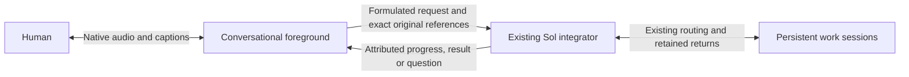

# Native voice foreground over the existing integrator

Human selection:1November2026. Owns the next #301/#302/#303/#304 implementation;
[this roadmap](interaction-roadmap.md) retains the complete horizon. This is an
implementation contract. The opt-in receiving pilot and bounded provider/browser
evidence are recorded in the roadmap and qualification record; physical-device
acceptance remains open.

## Conversation ownership

The person talks to a fluent voice layer. It listens, discusses, asks useful
clarifications and helps formulate a prompt. Ordinary conversation does not
create a Sol turn or worker task. When content requires resolution, the voice
layer submits it asynchronously to the existing integrating Conversation.
The Sol integrator retains routing, work progression and final-return ownership;
its persistent workers keep their own sessions. Integrating results/questions
return to the voice layer, which remains the interlocutor throughout.

The foreground distinguishes exploring an idea from requesting its execution.
It handles explanations and prompt refinement conversationally, uses available
context, and asks a brief clarification only when a missing detail materially
changes the requested outcome. A clear request goes to Sol without a redundant
confirmation step. Its formulation preserves constraints, uncertainty and
corrections. New speech remains conversational while work is pending; filler
acknowledgments do not count as useful-response latency.
After observed admission, the foreground should briefly confirm the actual
formulated request was handed over and stay conversational rather than wait
silently for its result. Pending/unconfirmed native acceptance is described as
such. This confirmation is an admission-status acknowledgment, not a useful work
result or evidence that the worker completed anything.
The confirmation describes the request as sent. It cannot imply that a named
worker received or started it from integrator admission alone; that requires
canonical worker confirmation.

Keep the work product separate from its spoken presentation. A request for a
complete unsummarized report with only its conclusion spoken still requires the
complete report to return to the integrator. Speech-only brevity or reading
preferences apply in this foreground, without restricting the worker deliverable.
A retained actual-Sol attempt exposed an ambiguous formulation and a spoken
acknowledgment that instead described requesting only the conclusion. This does
not prove a worker returned the wrong product: the fixture ended before a result.

When a requested conclusion/detail is absent from the current return page and a
next_offset exists, read onward before answering; describing where the answer
would be is not the answer. Continue only until the requested information is
found or that current source ends, under existing finite read/tool/session limits.
A distinct bounded native-provider check with simulated original/integrator
callbacks preserved the complete report, confirmed only that the request was
sent, read offset1600 of2370 and generated the granate conclusion. One earlier
candidate preserved the report but did not read past the first-page description;
its terminal failure remains retained. This is provider-policy evidence, not
actual-Sol/worker/device/hearing or general-latency acceptance.

Two bounded synthetic native-audio policy trials on1November observed the
exploration/execution distinction and this admission response separately. With
the earlier instruction, exploration stayed conversational and the later
explicit request used its supplied original reference, but no assistant output
preceded the deliberately delayed fake result. With the explicit admission
instruction, a separate one-request trial generated confirmation text536ms
after fake admission, before the delayed result, then presented that result.
Both used one provider connection and fake tools only, with no Sol/worker job,
human original, app change or hardware capture. This is an observed policy
response, not a controlled latency comparison or receiving acceptance. The
first PCM event contained only two bytes; it cannot establish intelligible
sound. Useful-result and physical-playback latency remain separate open measures.

On opening, assistant voice context is selected from the current integrating
binding. Earlier bindings remain in readable history, but are not silently
injected into the new voice conversation. Playback positions remain client
observations, not proof that the person heard the generated words.
The existing `recent_originals` read also includes up to four assistant speech
observations from the current dialogue and binding, within its16KiB tool-result
bound. It carries bounded generated-text excerpts, interruption/closed flags and
generated/client-playback byte positions. A later read reflects later playback;
this starts no native work and creates no second speech registry. The model must
not map those positions to exact heard words: they are neither word alignment
nor a contiguous hearing receipt. Phone interruption/correction acceptance
remains separate from this context plumbing.

A formulation is an attributed assistant derivative, never replacement human
speech. Preserve exact original utterances/transcripts, chronology and correction
relationships, alongside the selected prompt and its source references. A
partial caption or provider turn rotation does not admit a new work request.
Server authorization and existing task/approval boundaries still own effects;
voice tools do not gain direct worker, shell, global Stop or publication access.

## Recovered decisions and observed limits

The retained15October integrating-conversation research already separates a
Talker from a Reasoner, persistent work from temporary delegation, and returned
reports from job ownership. Its Qwen Live Harness inspection identifies useful
adapter/report scheduling seams; its in-memory report ledger is not our durable
work registry. Retain our existing owners and journals rather than adopting a
whole replacement harness.

The18October native account WebRTC experiment produced decoded synthetic Spanish
audio and incorporated a later correction. The earlier WebSocket API-key refusal
was transport-specific. That experiment did not qualify controlled backing-work
admission: client-managed handoff can suppress forwarding while native core still
starts work. Prompt-only instructions cannot fix that boundary. The26October
speech frontier retained these alternatives and the modular recovery path; its
initial modular recommendation is superseded for the fluent foreground by the
current human correction, not rewritten as if it had selected this rollout.

Current human evidence: avatar-only interaction occurred, but the person reports
nearly a minute before useful speech and an overlap on resuming speech. This
contradicts fluid-dialogue acceptance. Existing digital6–13second observations,
source primitives and a successful automatic upload do not establish fluency.

## Provider decision and actual access

First engineering candidate: **Gemini3.8Live**. Existing server credential and
read-only model discovery expose `gemini-3.8-live` and
`gemini-3.8-live-extended-thinking` with `bidiGenerateContent`. This is catalog
metadata only. Use native audio for this layer; retain Sol6.1/openai/medium
integrator/worker selection and existing Qwen rendering for ordinary paths.

- [Gemini Live](https://ai.google.dev/gemini-api/docs/live-api) documents native
  bidirectional audio, transcripts and interruption. Its
  [tool guide](https://ai.google.dev/gemini-api/docs/live-api/tools) describes
  nonblocking function execution and response scheduling. Verify those exact
  capabilities on the selected model; the documentation mixes model generations.
- [Extended thinking](https://ai.google.dev/gemini-api/docs/live-api/thinking)
  separates ongoing interaction from background reasoning. It remains a candidate
  if needed; fillers are not useful-response latency, and persistent Sol work
  must not become a hidden second reasoning job on every spoken exchange.
- [OpenAI Realtime](https://developers.openai.com/api/docs/guides/realtime-conversations)
  offers native speech, tools and interruption/truncation. Keep the already-tested
  account WebRTC route as the alternative, with its actual admission caveat;
  subscription login is not proof of general API-key entitlement.
- [Qwen Omni](https://help.aliyun.com/en/model-studio/realtime) documents native
  duplex audio and tools. Current3.8 deployment requires selected regional
  workspace access; existing3.0ASR/TTS use alone does not prove that grant.

No new account, purchase, provider ranking or voice migration follows from this
selection. One bounded synthetic native-audio/nonblocking-tool probe can resolve
that first protocol uncertainty. It cannot replace real audio-input, integrating
admission, interruption/reconnect, phone hearing or useful-latency acceptance.

## Selected-provider boundary observed —1November2026

One fresh bounded Gemini3.8Live session accepted the nonblocking tool declaration.
With one fake integrator call still pending, a separate synthetic conversational
prompt produced nonzero native PCM and the spoken response “Cinco”. Only then
was the fake integrator result returned; the model subsequently spoke its result.
The retained outcome records one tool call,240484PCM bytes and7.073seconds total
session time. This is a text-triggered native-audio/tool-concurrency observation,
not speech-input latency, real Sol delegation, physical hearing or app deployment.
No real native admission, human recording, worker action or provider retry ran.
The first implementation can therefore use the observed nonblocking seam rather
than adding a second reasoning turn for each casual spoken exchange.

## Implementation order and concrete seams

1. Inspect and extend the current owner APIs before adding a transport. Existing
   `TranscriptionStream` is deliberately transcription-only; do not quietly turn
   that recovery adapter into a conversational agent. Reuse its private server
   credential custody and supported WebSocket library, not its final-WAV gating.
2. Keep a foreground exchange independent of native job admission. The current
   ordinary input writer starts native work; sending every chatter utterance
   through it unchanged would recreate the serial path. Extend the existing
   original/source journal with explicit foreground provenance and one retained
   delegation intent. Do not fabricate a human user message from a model summary.
3. Give the voice layer a small server-owned integrator bridge: submit a request
   tied to exact originals, observe its existing retained status, and receive its
   attributed returns. Ack means accepted, not resolved. Reuse current source
   revisions, frozen question scope, uncertainty and canonical return ownership;
   do not install another worker registry or model poller.
4. Keep the native audio loop free of native-turn/ASR-final/TTS waits. On an
   interruption, silence/discard only the affected output and track heard/unsaid
   context. Provider tool-call cancellation does not cancel admitted Sol work.
   A disconnected voice session observes existing outcomes on return, without
   reauthoring jobs or resubmitting uncertain provider/native requests.
5. Mount the qualified adapter inside the existing avatar view and shared login,
   retaining normal composer drafts, files, reply selection, text access and
   ordinary chat. Expose the real selected mode and actual readiness/errors.
   Keep server-side credentials private and current actor/generation checks on
   tool effects. Preserve ongoing captures during receiving adoption.

## Foreground original retention seam

The owner command `input foreground retain JSON` accepts `binding`, `id`, `text`,
`dialogue_id` and an optional frozen `capture_questions` narrowing map. It stores
an exact original in the existing conversation journal with phase `foreground`.
Status and history expose that grouping; `native_acceptance` is `not_requested`.
It neither routes work, answers questions nor calls the native worker. Repeating
the exact identity observes the retained original; changing its text or dialogue,
or submitting it through the ordinary input command, is rejected. The ordinary
input schema and admission behavior remain unchanged.

The separate owner command `input foreground delegate JSON` takes `binding`,
`id` (the latest original), `intent_id`, `formulation` and `source_ids`. It freezes
up to8same-dialogue originals in capture order, their exact text/hash and captured
server question versions, under an immutable intent. Source context is bounded
to64KiB and the assistant formulation to8KiB. A newer captured correction must be
the root. The original text remains unchanged. Admission queues that root directly
to the existing integrator, bypassing voice-selected destinations and automatic
question answering. A repeated exact intent only observes its outcome, including
uncertainty or known-unsent restart recovery; it never resubmits work. Changing
its formulation, source set or intent identity is rejected.

The integrator receives a labelled assistant derivative and exact frozen sources.
If it later dispatches the selected original, the normal worker packet carries
that same attributed context beside the unchanged human text. Ordinary routing,
source identity validation and return ownership remain in force. The native
socket regression deliberately includes an unknown worker selector in the latest
original: delegation still enters the integrator once rather than selecting that
worker from the voice layer.

These are native owner primitives under implementation, not an activated browser
mode. The dialogue UUID groups originals and grants no authority. The live
audio/activity capture bridge and avatar mounting remain unfinished. Store/restart and
owner-socket regressions exercise exact-source identity, stale/cross-dialogue
rejection, once-only delegated admission and absence of work for casual retention,
without invoking a model.

## Source-bound foreground audio retention

The server-side `Provider.conversation_voice_submit` supports an explicit
`foreground_dialogue` keyword; ordinary HTTP uploads do not expose that keyword.
The same private bounded WAV store, hash checks, selected original-media protection,
decoder and native capture journal are reused. Foreground capture requires the
configured completed-transcript reader, which cannot initiate file ASR. A missing
receipt remains recoverable preparation, never a fallback model call or work
admission. Native3.8 transcripts use the same source/hash/PCM-verified prepared
receipt as the existing transcription providers.

At the acoustic endpoint, the server can retain the exact WAV with
`defer_foreground=True` before its provider transcript arrives. This records
`foreground_captured` and receiver capture order without starting any reader or
work. A later `conversation_foreground_complete` reads only the now-completed
receipt for that same original/dialogue. Restart retains the captured source and
its frozen question scope. A delayed transcript cannot move it after a later
captured correction. Capacity-unavailable foreground preparation follows that
same known-unsent capture path; no failed provider operation is retried.

After committing that receiving-owned proof, the native capture moves to
`foreground` and does not invoke routing, answer a question or submit a Sol turn.
Explicit later delegation includes the voice proof in its frozen source context,
retaining automatic-transcription attribution. Ordinary chat and capture/recovery
keep their existing behavior. Source context also bounds the entire encoded
retained outcome to192KiB, below the existing256KiB owner reply limit, so JSON
escaping cannot leave a queued request with an unreadable acknowledgment.

This completes the owner-side audio commit primitive; the live activity/source
bridge, session continuity and avatar mounting remain unfinished. It does not
claim a natural end-of-phrase or phone qualification. Original byte retirement
continues through the existing policy after durable text and any selected media
protection, with the same256MiB unresolved-capture budget; no new archive or
background retention process is introduced.

## Native dialogue transport seam

`dashboard/native_dialogue.py` implements the dedicated Gemini3.8Live transport;
ordinary `TranscriptionStream`, Sol configuration and Qwen rendering are unchanged.
The transport requires explicit `manual` or `automatic` activity ownership and
supports concurrent PCM input, audio output, captions and nonblocking integrator
proposals. Manual start/end are bridge-owned acoustic events, never text captions;
provider acknowledgments of those events are labelled separately from automatic
voice detection. Stopping a microphone closes its active manual activity or sends
the documented automatic-mode `audioStreamEnd`. It has no native
submission, worker, storage, reconnect or automatic retry capability. Proposals
carry an assistant formulation and bounded original IDs; only the owning bridge
can validate their actual retained source/actor/binding and admit work.

The adapter exposes provider input transcripts separately from interim captions.
Transcription text is optional in the provider schema. Empty transcription
metadata without an explicit input-end marker is ignored, while audio carried
in that same message is still delivered. A mounted real-provider trial observed
`outputTranscription:{}` alongside generated PCM; requiring its missing text
closed the session. The regression reproduces that rejection and verifies that
the corrected parser keeps the audio without inventing a human transcript.
It deliberately does not interpret model output or `turnComplete` as a final human
original: the [Live protocol](https://ai.google.dev/api/live) gives no guaranteed
ordering between input transcription and other events. The capture/source bridge
still needs to establish durable utterance/audio boundaries before delegation.
Provider cancellation is a cancelled speech proposal, never a native job cancel.
An interrupted event clears output, including audio in that same event. A tool
response is marked uncertain before writing and cannot be replayed. The return
subscription uses the provider's documented
[`FunctionResponse.willContinue`](https://googleapis.github.io/js-genai/release_docs/classes/types.FunctionResponse.html)
to stream distinct canonical updates on one nonblocking call. Receiving an
acknowledgment does not end that subscription or depend on another model call.

Each connection is limited to300seconds,300seconds of16kHz input and24kHz output,
16384provider events,256KiB per event,128KiB total transcripts,32tool proposals and
4pending proposals and160total tool responses, including streamed updates.
Only admitted delegation and return-subscription calls can continue. Each input frame is at most one second; request/source lists
and returned outcomes are bounded. The adapter retains no media or transcripts
after its owner releases it and never opens a replacement connection. Longer
conversation continuity belongs to the existing durable source/result bridge,
not automatic replay. Synthetic socket regressions cover concurrent speech while
a tool is pending, interruption, once-only uncertain returns and resource bounds;
they establish no real audio-input, native admission, avatar or phone acceptance.

Native manual activity uses the existing owned acoustic worker with an explicit
1600ms silence endpoint as a fallback when the semantic score does not close a
phrase. The event is labelled `acoustic_silence`, with measured silence duration,
not a semantic completion probability or proof of final intended words. Only
confirmed speech can establish that boundary. A resumed utterance can interrupt
the response and supply a correction; a pause does not cancel native work.
Ordinary prepared/file-ASR modes retain their previous semantic-only policy.
The worker advertises the selected silence policy at readiness, before opening
the paid provider or requesting the browser microphone; an old worker cannot
silently impersonate support. Receiving adoption must select the matching
`capture_turn.py` command and completed-transcript reader with the backend.

## Actual audio-input qualification —1November2026

The synthetic audio-input journey did not establish automatic end-of-phrase:
setup succeeded, but continuous PCM and silence produced no transcript, activity
or output before the finite deadline. Documented microphone-stop handling and
the official SDK's outer message spelling did not resolve that observation.
Explicitly enabling automatic detection likewise produced no response. Those
outcomes remain retained failures, not fluency or provider-wide capability claims.

A distinct diagnostic using the supported manual activity protocol did produce
an input transcript, provider activity acknowledgments and native PCM with the
matching arithmetic answer. Its first audio arrived674ms after the explicit
microphone-stop signal; the entire synthetic session lasted12.323seconds. This
is a protocol/audio-intake observation, not independently heard speech or a
measurement from a natural intended pause. No human recording or Sol/native
work admission was used. The provider transcript omitted the synthetic greeting;
retain original audio and label its transcript as an automatic interpretation,
never assume that transcription alone preserves the entire spoken original.

The first source/capture bridge must therefore use explicit, owned acoustic
activities for the observed manual protocol, with the existing detector and its
actual offsets. Keep audio generation independent of final file ASR, Sol work
and separate TTS. The automatic provider mode remains unqualified. Device end
of phrase, echo/noise, interruption and useful latency still require an integrated
journey; successful explicit start/end cannot close those acceptance items.

## Bounds and acceptance

Start with one owned synthetic provider session,60seconds, at most1024events,
4MiB generated PCM and192output tokens per response; one delayed fake integrator
call and one second conversational prompt. No hardware, existing human recording,
real worker action, new native input, reconnect or replay. Retain its terminal
outcome and metadata; only reproducible synthetic media may be retired later.

Then qualify the actual integrator bridge and audio-input/output journey under
finite selected capture/output budgets. Show useful speech while an integrator
request is pending, a later sourced return, a spoken prompt correction, speech
interruption without worker cancellation, and reconnect with once-only originals.
Measure final intended speech→first intelligible sound and interruption→silence
on the same journey; count neither filler nor first text as spoken acceptance.
Phone/echo/noise acceptance stays distinct. Existing selected participants' access,
bounded media retention and ordinary original recovery remain requirements.

## Live bridge implementation checkpoint

`dashboard/native_foreground.py` connects one bounded native speech session to
existing original retention, integrator admission and canonical text readers.
Its `recent_originals` tool returns genuine references; delegation requires the
latest captured correction and retains its distinct assistant formulation. Each
provider call ID can produce at most one owner invocation, including lost ACKs.
The first admitted delegation itself stays pending with `willContinue:true` and
owns the existing event-driven return reader. The model does not need to make a
second tool call to hear its result or a returned question. Later admissions
reuse that reader instead of creating another one. `await_integrator_update`
remains available for pending work without an active continued delegation/watch,
including recovery after provider cancellation. The speech stream remains
independent. The bridge re-reads the selected revision and rejects
obsolete content, pending corrections, worker progress and changed native bindings.
It never starts workers itself or treats admission as task completion.

A long integrating return retains its canonical `offset`/`next_offset` in the
voice tool response. `read_integrating_source` reads one requested page through
the existing presentation reader, restricted to exact source/revision pairs
already offered in this dialogue. Each page rechecks currentness, correction and
native-binding state, canonical kind and offset before returning text. An obsolete
source or unrelated ID returns no text; the foreground must not invent missing
details from a truncated first page. The offered-reference dictionary uses the
existing128offer/session bound; each read uses the same finite tool-call and
16KiB response bounds. It starts no work, answers no native question and creates
no parallel source store. Mocked transport, source ownership and mounted app
regressions cover a multi-page Unicode result and changed/unoffered sources;
these do not establish real-provider tool selection or phone hearing.

An answer to an integrating question or a correction to pending work must also
reach Sol through its retained originals, even if terse. The foreground cannot
replace that action with a spoken acknowledgment or claim forwarding before
observed admission. Original question/approval authority still belongs to the
existing integrator and native controls; no automatic native answer is added.
The source list must be refreshed after each new answer/correction; a cached ID
from the earlier request cannot replace that new original. The existing owner
rejects a proposal that omits the latest captured source without admitting work.

The bridge retains exact PCM as the existing private WAV before native control,
then uses the existing prepared-transcript receipt and completed reader. Closing
the voice session releases live buffers and wakes a pending return watch. A file
write already in progress owns immutable bytes until it finishes; closing speech
does not cancel an integrating task. Bounds remain300seconds/128captures,
4pending captures,2owner calls,1file writer and8queued source references. The opt-in WebSocket/avatar mounting is described below; no receiving deployment
is established by these source tests.

The native `voice capabilities` response advertises `foreground_retention: v1`
and `foreground_completed_reader`. The mounted mode checks both before offering its microphone; the current selected
receiving listener predates these fields.
Source mounting, assistant speech history and playback are implemented behind
the opt-in flag below. The actual provider/native/device journey remains open.

`dashboard/native_acoustic.py` maps the existing server detector's exact onset
and endpoint observations to the observed manual native-audio protocol. An
endpoint sends `activityEnd` before transcript completion, native admission or
integrator work. Only analyzed PCM reaches that stream, and the retained closed
WAV contains those exact bytes. A single outstanding provider activity owns its
finalized input transcript and matching manual start/end audio offsets. Output
completion and interim captions do not finalize originals. Up to4local phrases
can wait in acoustic order while that correlation finishes; native reservations
also serialize so a slower earlier write cannot reverse ingress chronology.
Closing retains an unfinished phrase's captured tail without delegating it.

Explicit fragmented input transcription preserves the provider's optional
[`finished` marker](https://googleapis.github.io/js-genai/release_docs/interfaces/types.Transcription.html).
Marked fragments accumulate within the existing16000byte original bound, even
when arriving before local phrase end. A textless `finished:true` ends that
transcription; completion still requires the matching manual audio-end ACK.
Model output/turn completion does not substitute for it. Cumulative captions
remain visible; the empty end marker cannot erase them. Once fragmentation is
explicit, an unmarked later fragment does not silently become the full original.
The previously observed single unmarked transcript path remains supported.
Synthetic transport/acoustic/mounted tests establish these conditions, not that
the selected provider always emits this marker or preserves every long spoken
word. Real long-utterance and unmarked segmentation qualification remain open.

The acoustic adapter is mounted behind the opt-in native route. Its synthetic
tests establish offset
and source correlation, endpoint signaling before transcript arrival, bounded
backlog and preservation on close. They do not qualify the actual detector,
provider session, responsive speech or device behavior. The next paid provider
session must use the complete mounted source/audio/integrator journey rather
than another isolated arithmetic or transport probe.

## Opt-in mounted browser path

`streaming_transcription.native_dialogue = true` mounts the authenticated
`/api/interaction/voice/native` WebSocket when the existing prepared Gemini
credential and acoustic detector are configured. Default is false. The avatar
selects it only when the server advertises it and the browser supports the PCM
path. The Android native audio client retains the existing mode in this pilot.
Normal chat, selected Sol workers, ASR and Qwen playback remain available.

The route reuses shared login, exact Origin, CSRF and current entry checks. It
checks the loaded native capabilities, completed reader and history capacity
before opening the provider or offering microphone acquisition. Input, detector
and provider events use bounded batches while fresh authorization is in flight;
there is no authorization cache. Each live route has a305second outer deadline,
one session per actor and the existing shared foreground-analysis capacity of
at most2sessions. A disconnected ASGI request cannot
skip provider closure or the separate bounded cleanup of already captured data.

Before microphone acquisition, a bounded source-labelled context includes recent
owned integrating text, original excerpts and assistant voice history. Those
prior source IDs are contextual only; a delegation still requires genuine
current-dialogue originals. One pending event-driven reader, normally attached
to the admitted delegation call, consumes current
integrating result/question references, not arbitrary worker history. Source
revision/currentness is checked again at offer time. Synthetic socket tests prove
that native audio continues while this watch is pending and that successive
canonical returns use the same subscription without repeating admission. Stale
sources are skipped without ending it; exact revisions are read again at offer
time. The session-new source window is revalidated on invalidations because
currentness/publication metadata can change without a new row ID.

The browser retains exact PCM ranges through the existing IndexedDB/WAV recovery
path until the authenticated server confirms matching original hashes **and durable
interpretations**. A raw-WAV retention ACK alone never retires the local copy. A first
local acoustic marker freezes that phrase's observed question versions before
its PCM is sent; the server intersects this narrowing scope with native-owned
questions. Missing markers retain the earlier arm-time fallback. No late Send,
retry or transcript completion widens that scope. Unconfirmed copies remain for
review on exit. Native PCM playback has a30second/512node queue bound, ordinary
speaker and pause/resume controls, and matching phrase-ACK fences against an
interrupted output restarting. The first local acoustic marker also retires the
latest received output ID and all queued output IDs before server onset arrives,
including when playback is between chunks. Late chunks still validate byte
continuity but cannot restart those utterances; a fresh output ID can play.
Retired IDs are bounded by the existing finite session/event limit and cleared
on exit or a new session. The existing Chromium offline-audio qualification
renders both active-playback and between-chunk interruption, plus fresh output
afterward. It measures rendered graph silence against a synthetic local marker,
not physical microphone-to-silence latency. Browser playback counters are
observations, not proof of physical hearing or exact word uptake. Stopping a
queued buffer before its scheduled start reports no played bytes for that buffer;
its cumulative begin offset must not advance the utterance playback observation.
The offline-audio regression queues two chunks before interruption and checks
the reported position against elapsed rendered time as well as the silent tail.

Assistant utterances live as explicitly assistant-authored records in the
existing app state database. They are not human inputs or invented native work
results. Full text and Copy remain available in the normal timeline, including
interrupted text marked as possibly unheard, with bounded16item history paging.
History retains at most16384utterances/64MiB of text; capacity exhaustion stops
new native voice rather than deleting history. No automatic expiry or archive is
introduced. Existing original media retention remains its own owner. Only text
and turn changes notify the existing event stream; PCM/playback bookkeeping does
not cause whole-conversation refresh loops.

Current evidence is source and synthetic mounted journeys, including revoked
actor/old-listener refusal, exact WAV/source identity, independently retained
assistant history, asynchronous delegation/returns, ordered originals and browser
recovery/interruption controls. The real integrated provider/native journey,
useful-speech latency, precise heard/unsaid uptake, actual receiving adoption and
human device/hearing remain
unqualified. No new phone test is implied until those receiving steps finish.

## Receiving browser pilot —1November2026

PR496/sourceba9ed22 is receiving-selected as **UIc99f1b340f67**, after full
CI41303898080 and Android/decoder41303898081 passed. Exact local/public assets,
loaded native capabilities and the compatible worker/reader were verified.
Existing native writers/goals, the native daemon, Nexus source-policy environment
and unknown inputs were preserved. Ordinary chat/Qwen and Android native audio
retain their existing paths; the browser avatar explicitly opens this pilot.

A real mounted Gemini/Sol journey retained two originals, kept speech available
during pending work, handled interruption and spoke the canonical returned
recommendation using one continued subscription. Synthetic actors/worker/audio
and generated PCM do not establish rendered-browser or human hearing acceptance.
The first reply measured11.036s versus1.094s for the following conversational
response; useful latency and the remaining full roadmap are unfinished. The
human browser pause/response/interruption trial was requested for this exact UI.
See [qualification](interaction-qualification.md#native-foreground-qualification)
and the receiving operator record for current adoption and software rollback.
After native foreground originals exist, keep compatible native/completed-reader
support when restoring an earlier web UI; never roll back source journals.

## Native avatar recovery feedback

When native voice stops with an unconfirmed original, its continuous state reports
review pending. The avatar shows the actual stop reason and the existing return
to conversation recovery action, and hides Start voice until that original is
reviewed. With no original, a stopped session still shows its reason rather than
leaving only Voice paused and an old caption. Ordinary composer/playback updates
do not erase that reason; explicitly starting voice again clears it. This uses
the existing local recording store/recovery path, not a second sender, retry or
provider action. It changes no endpointing, native admission or job cancellation.
