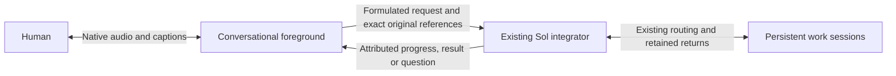

# Native voice foreground over the existing integrator

Human selection:1November2026. Owns the next #301/#302/#303/#304 implementation;
[this roadmap](interaction-roadmap.md) retains the complete horizon. This is an
implementation contract, not a claim that native speech is deployed.

## Conversation ownership

The person talks to a fluent voice layer. It listens, discusses, asks useful
clarifications and helps formulate a prompt. Ordinary conversation does not
create a Sol turn or worker task. When content requires resolution, the voice
layer submits it asynchronously to the existing integrating Conversation.
The Sol integrator retains routing, work progression and final-return ownership;
its persistent workers keep their own sessions. Integrating results/questions
return to the voice layer, which remains the interlocutor throughout.

A formulation is an attributed assistant derivative, never replacement human
speech. Preserve exact original utterances/transcripts, chronology and correction
relationships, alongside the selected prompt and its source references. A
partial caption or provider turn rotation does not admit a new work request.
Server authorization and existing task/approval boundaries still own effects;
voice tools do not gain direct worker, shell, global Stop or publication access.

## Recovered decisions and observed limits

The retained15October integrating-conversation research already separates a
Talker from a Reasoner, persistent work from temporary delegation, and returned
reports from job ownership. Its Qwen Live Harness inspection identifies useful
adapter/report scheduling seams; its in-memory report ledger is not our durable
work registry. Retain our existing owners and journals rather than adopting a
whole replacement harness.

The18October native account WebRTC experiment produced decoded synthetic Spanish
audio and incorporated a later correction. The earlier WebSocket API-key refusal
was transport-specific. That experiment did not qualify controlled backing-work
admission: client-managed handoff can suppress forwarding while native core still
starts work. Prompt-only instructions cannot fix that boundary. The26October
speech frontier retained these alternatives and the modular recovery path; its
initial modular recommendation is superseded for the fluent foreground by the
current human correction, not rewritten as if it had selected this rollout.

Current human evidence: avatar-only interaction occurred, but the person reports
nearly a minute before useful speech and an overlap on resuming speech. This
contradicts fluid-dialogue acceptance. Existing digital6–13second observations,
source primitives and a successful automatic upload do not establish fluency.

## Provider decision and actual access

First engineering candidate: **Gemini3.8Live**. Existing server credential and
read-only model discovery expose `gemini-3.8-live` and
`gemini-3.8-live-extended-thinking` with `bidiGenerateContent`. This is catalog
metadata only. Use native audio for this layer; retain Sol6.1/openai/medium
integrator/worker selection and existing Qwen rendering for ordinary paths.

- [Gemini Live](https://ai.google.dev/gemini-api/docs/live-api) documents native
  bidirectional audio, transcripts and interruption. Its
  [tool guide](https://ai.google.dev/gemini-api/docs/live-api/tools) describes
  nonblocking function execution and response scheduling. Verify those exact
  capabilities on the selected model; the documentation mixes model generations.
- [Extended thinking](https://ai.google.dev/gemini-api/docs/live-api/thinking)
  separates ongoing interaction from background reasoning. It remains a candidate
  if needed; fillers are not useful-response latency, and persistent Sol work
  must not become a hidden second reasoning job on every spoken exchange.
- [OpenAI Realtime](https://developers.openai.com/api/docs/guides/realtime-conversations)
  offers native speech, tools and interruption/truncation. Keep the already-tested
  account WebRTC route as the alternative, with its actual admission caveat;
  subscription login is not proof of general API-key entitlement.
- [Qwen Omni](https://help.aliyun.com/en/model-studio/realtime) documents native
  duplex audio and tools. Current3.8 deployment requires selected regional
  workspace access; existing3.0ASR/TTS use alone does not prove that grant.

No new account, purchase, provider ranking or voice migration follows from this
selection. One bounded synthetic native-audio/nonblocking-tool probe can resolve
that first protocol uncertainty. It cannot replace real audio-input, integrating
admission, interruption/reconnect, phone hearing or useful-latency acceptance.

## Selected-provider boundary observed —1November2026

One fresh bounded Gemini3.8Live session accepted the nonblocking tool declaration.
With one fake integrator call still pending, a separate synthetic conversational
prompt produced nonzero native PCM and the spoken response “Cinco”. Only then
was the fake integrator result returned; the model subsequently spoke its result.
The retained outcome records one tool call,240484PCM bytes and7.073seconds total
session time. This is a text-triggered native-audio/tool-concurrency observation,
not speech-input latency, real Sol delegation, physical hearing or app deployment.
No real native admission, human recording, worker action or provider retry ran.
The first implementation can therefore use the observed nonblocking seam rather
than adding a second reasoning turn for each casual spoken exchange.

## Implementation order and concrete seams

1. Inspect and extend the current owner APIs before adding a transport. Existing
   `TranscriptionStream` is deliberately transcription-only; do not quietly turn
   that recovery adapter into a conversational agent. Reuse its private server
   credential custody and supported WebSocket library, not its final-WAV gating.
2. Keep a foreground exchange independent of native job admission. The current
   ordinary input writer starts native work; sending every chatter utterance
   through it unchanged would recreate the serial path. Extend the existing
   original/source journal with explicit foreground provenance and one retained
   delegation intent. Do not fabricate a human user message from a model summary.
3. Give the voice layer a small server-owned integrator bridge: submit a request
   tied to exact originals, observe its existing retained status, and receive its
   attributed returns. Ack means accepted, not resolved. Reuse current source
   revisions, frozen question scope, uncertainty and canonical return ownership;
   do not install another worker registry or model poller.
4. Keep the native audio loop free of native-turn/ASR-final/TTS waits. On an
   interruption, silence/discard only the affected output and track heard/unsaid
   context. Provider tool-call cancellation does not cancel admitted Sol work.
   A disconnected voice session observes existing outcomes on return, without
   reauthoring jobs or resubmitting uncertain provider/native requests.
5. Mount the qualified adapter inside the existing avatar view and shared login,
   retaining normal composer drafts, files, reply selection, text access and
   ordinary chat. Expose the real selected mode and actual readiness/errors.
   Keep server-side credentials private and current actor/generation checks on
   tool effects. Preserve ongoing captures during receiving adoption.

## Bounds and acceptance

Start with one owned synthetic provider session,60seconds, at most1024events,
4MiB generated PCM and192output tokens per response; one delayed fake integrator
call and one second conversational prompt. No hardware, existing human recording,
real worker action, new native input, reconnect or replay. Retain its terminal
outcome and metadata; only reproducible synthetic media may be retired later.

Then qualify the actual integrator bridge and audio-input/output journey under
finite selected capture/output budgets. Show useful speech while an integrator
request is pending, a later sourced return, a spoken prompt correction, speech
interruption without worker cancellation, and reconnect with once-only originals.
Measure final intended speech→first intelligible sound and interruption→silence
on the same journey; count neither filler nor first text as spoken acceptance.
Phone/echo/noise acceptance stays distinct. Existing selected participants' access,
bounded media retention and ordinary original recovery remain requirements.
